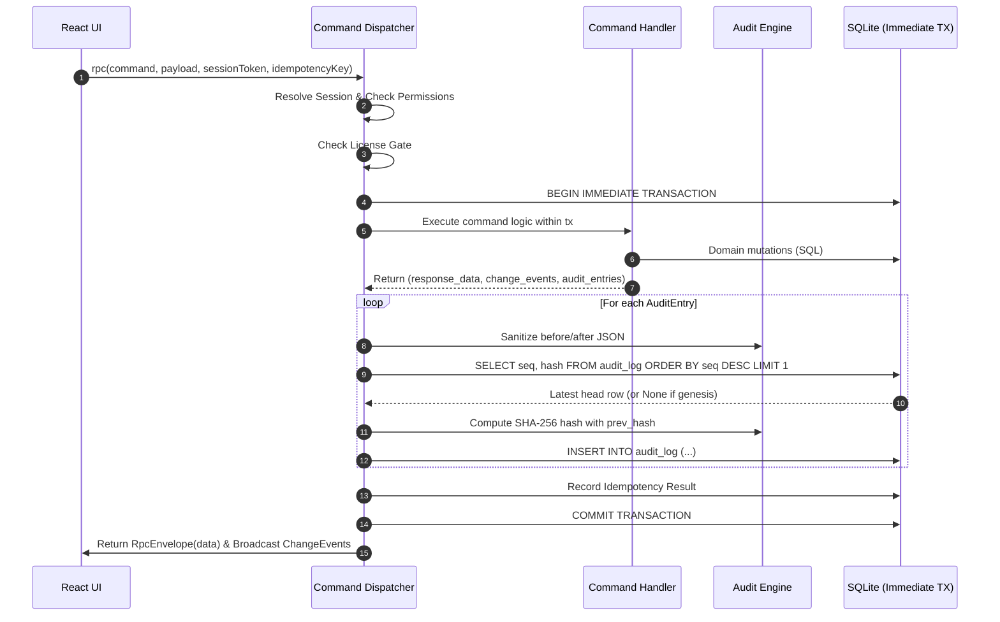

# 0005. Audit log and cryptographic hash chain

**Date**: 2026-09-20
**Status**: Accepted

## Summary

Coachify maintains an append-only, insert-only audit trail in SQLite that records every administrative modification, financial event, and security-critical action. Each record is cryptographically linked to its predecessor using a SHA-256 hash chain, guaranteeing that any insertion, deletion, reordering, or modification of historical records is immediately detected. Audit records are written inside the exact same database transaction as the domain mutation to eliminate divergence. Sensitive fields (including plaintext passwords, password hashes, session tokens, and cryptographic keys) are recursively scrubbed from change payloads prior to hashing and persistence. A diagnostics engine scans and validates chain integrity on demand, providing proof of log integrity that is embedded into backup manifests to protect against staff fraud and record tampering.

## Requirements

**User stories**:
- As an institute owner, I want every financial and administrative action permanently recorded so that dishonest staff cannot alter cash records, waive fees, or manipulate exam marks without an indisputable paper trail.
- As an institute owner, I want cryptographic assurance that historical records have not been altered or deleted in the database file so that I can trust my financial reports and backup archives completely.
- As a software engineer, I want audit records captured automatically inside the same database transaction as domain commands so that audit entries never diverge from persisted state.
- As a security auditor, I want sensitive authentication data (like passwords, token hashes, and secrets) permanently redacted from audit payloads so that audit logs do not become credential attack vectors.
- As an administrator, I want an in-app audit log viewer with filtering, change diff inspection, and a one-click chain integrity verification tool so that I can audit daily center activity and verify system integrity without technical database tools.

**Acceptance criteria**:
- **AC-1**: Every state-modifying mutation command and security event (such as `system.bootstrap_owner`, `users.create`, `users.update`, `roles.create`, `roles.update`, `auth.change_password`, and failed logins) writes an audit record to `audit_log` within the exact same database transaction as the business operation.
- **AC-2**: The audit log forms a continuous cryptographic SHA-256 hash chain where each row's hash is computed over `prev_hash`, timestamp (`at`), civil business date (`business_date`), actor user ID (`user_id`), workstation device ID (`device_id`), action name (`action`), target entity type (`entity`), target entity ID (`entity_id`), and sanitized change state (`before_json`, `after_json`). The genesis record (`seq = 1`) has `prev_hash` equal to 64 hex zeros (`0000000000000000000000000000000000000000000000000000000000000000`).
- **AC-3**: Sensitive fields (including `password`, `password_hash`, `new_password`, `current_password`, `session_token`, `token_hash`, `secret_ref`, `secret`, `private_key`, `encryption_key`) are recursively scrubbed and replaced with `"[REDACTED]"` in `before_json` and `after_json` prior to hash computation and database persistence.
- **AC-4**: SQLite triggers `trg_audit_log_no_update` and `trg_audit_log_no_delete` reject any attempt to update or delete rows in `audit_log`, aborting the operation with an explicit error message.
- **AC-5**: A diagnostics verification engine and RPC command (`audit.verify_chain`) verifies the entire log from genesis to head, asserting sequence continuity (`seq_i = seq_{i-1} + 1`), link hash equality (`prev_hash_i = hash_{i-1}`), and payload hash correctness, reporting the head hash and identifying the exact sequence number and failure reason of any tampering.
- **AC-6**: Core exposes typed query commands (`audit.list`, `audit.verify_chain`, `audit.get_head`) gated by the `audit.view` permission, supporting filtering by actor, entity type, entity ID, action, date range, and pagination.
- **AC-7**: The user interface provides a dedicated Audit Log view under Settings with a chronological timeline, filter controls, before/after diff inspection modal, and an interactive "Verify Chain Integrity" diagnostics badge that displays cryptographic verification status.

## Decision

**Chosen option**: Option 1: Cryptographic SHA-256 Hash Chain with In-Transaction Dispatcher Post-Execution Recording, Recursive Field Redaction, and On-Demand Diagnostics Verification.

You build the Coachify audit log engine in `crates/core/src/audit.rs`, integrating recording into the command dispatcher's transaction pipeline, enforcing sensitive field scrubbing via recursive JSON filtering, validating immutability via existing SQLite triggers, and providing chain verification and typed RPC queries with an accessible React view.

**Implementation skills**: `rust-best-practices` (`apollographql/skills`, `.claude/skills/rust-best-practices/`) · `tanstack-query` (`tanstack-skills/tanstack-skills`, `.claude/skills/tanstack-query/`) · `react-patterns` (`.claude/skills/react-patterns/`)

## Rationale

Reasoning and options: see [rationale.md](rationale.md).

## Feature design

### Data model sketch

The `audit_log` table is created in migration 0006 with engine-level immutability triggers. Migration 0008 adds performance lookup indexes, seeds the `audit.view` permission in the `permissions` catalog, and grants it to the `Owner` system role.

```sql
-- Append only audit trail with cryptographic hash chain (Migration 0006)
CREATE TABLE IF NOT EXISTS audit_log (
    seq INTEGER PRIMARY KEY AUTOINCREMENT,
    at TEXT NOT NULL, -- ISO 8601 UTC timestamp
    business_date TEXT NOT NULL, -- YYYY-MM-DD Asia/Dhaka civil date
    user_id TEXT, -- User ID of actor (NULL for system/bootstrap)
    device_id TEXT, -- Workstation/device ID
    action TEXT NOT NULL, -- e.g. 'users.create', 'users.update', 'auth.change_password'
    entity TEXT NOT NULL, -- e.g. 'user', 'role', 'session', 'payment'
    entity_id TEXT NOT NULL, -- UUIDv7 or identifier of entity
    before_json TEXT, -- Serialized JSON state prior to mutation (sanitized)
    after_json TEXT, -- Serialized JSON state after mutation (sanitized)
    prev_hash TEXT NOT NULL, -- 64 zeros for seq = 1, otherwise previous row hash
    hash TEXT NOT NULL -- SHA256 over canonical audit payload
);

-- Defense in depth triggers (Migration 0006)
CREATE TRIGGER IF NOT EXISTS trg_audit_log_no_update
BEFORE UPDATE ON audit_log
BEGIN
    SELECT RAISE(ABORT, 'Audit log records are immutable and cannot be updated');
END;

CREATE TRIGGER IF NOT EXISTS trg_audit_log_no_delete
BEFORE DELETE ON audit_log
BEGIN
    SELECT RAISE(ABORT, 'Audit log records are immutable and cannot be deleted');
END;

-- Query optimization indexes (Migration 0008)
CREATE INDEX IF NOT EXISTS idx_audit_log_at ON audit_log(at);
CREATE INDEX IF NOT EXISTS idx_audit_log_business_date ON audit_log(business_date);
CREATE INDEX IF NOT EXISTS idx_audit_log_entity ON audit_log(entity, entity_id);
CREATE INDEX IF NOT EXISTS idx_audit_log_user ON audit_log(user_id);
CREATE INDEX IF NOT EXISTS idx_audit_log_action ON audit_log(action);

-- Seed audit.view permission (Migration 0008)
INSERT OR IGNORE INTO permissions (code, module, description) VALUES
    ('audit.view', 'system', 'View audit trail timeline, before/after change diffs, and verify cryptographic chain integrity');

INSERT OR IGNORE INTO role_permissions (role_id, permission_code)
SELECT id, 'audit.view' FROM roles WHERE name = 'Owner';
```

### Cryptographic Hash Chain Specification

Each audit entry computes its SHA-256 hash over a canonical JSON payload structure with fixed, alphabetically sorted keys:

```rust
#[derive(Serialize)]
struct CanonicalAuditPayload<'a> {
    action: &'a str,
    after_json: Option<&'a str>,
    at: &'a str,
    before_json: Option<&'a str>,
    business_date: &'a str,
    device_id: Option<&'a str>,
    entity: &'a str,
    entity_id: &'a str,
    prev_hash: &'a str,
    user_id: Option<&'a str>,
}
```

1. **Genesis Record (`seq = 1`)**:
   - `prev_hash`: `"0000000000000000000000000000000000000000000000000000000000000000"` (64 hex zeros).
2. **Subsequent Records (`seq = N`)**:
   - `prev_hash`: Exactly equals the `hash` string of row `seq = N - 1`.
3. **Hash Calculation**:
   - Serialize `CanonicalAuditPayload` into JSON bytes.
   - Hash with SHA-256 (`sha2::Sha256`).
   - Format as a 64-character lowercase hexadecimal string.
4. **Backup Integration**:
   - The head hash (`SELECT hash FROM audit_log ORDER BY seq DESC LIMIT 1`) is recorded in backup manifests (`.coachifybackup`).
   - When restoring or inspecting backups, verifying the head hash guarantees that historical records have not been rewritten post-backup.

### Sensitive Field Redaction Rules

Before `before_json` or `after_json` are serialized and hashed, change payloads undergo recursive sanitization:

```rust
pub const SENSITIVE_KEYS: &[&str] = &[
    "password",
    "password_hash",
    "new_password",
    "current_password",
    "session_token",
    "token_hash",
    "token",
    "secret_ref",
    "secret",
    "private_key",
    "encryption_key",
];
```

The redaction engine recursively inspects JSON objects and arrays:
- Keys matching `SENSITIVE_KEYS` (case-insensitively) have their values replaced with `"[REDACTED]"`.
- Primitive values and non-sensitive fields retain their original values.
- Empty or `None` states remain `None`.

### Command Dispatcher Integration Flow



### Chain Verification Algorithm

```rust
pub struct AuditVerificationReport {
    pub is_valid: bool,
    pub total_records: u64,
    pub head_seq: Option<u64>,
    pub head_hash: Option<String>,
    pub broken_seq: Option<u64>,
    pub failure_reason: Option<String>,
    pub verified_at: String,
}
```

1. Read all rows from `audit_log` ordered by `seq ASC`.
2. For row 1:
   - Verify `row.seq == 1`.
   - Verify `row.prev_hash == "0".repeat(64)`.
3. For row $i > 1$:
   - Verify `row.seq == prev_seq + 1` (no gaps or deleted rows).
   - Verify `row.prev_hash == prev_hash` (unbroken cryptographic link).
4. For all rows:
   - Recompute canonical SHA-256 hash.
   - Verify `recomputed_hash == row.hash` (unaltered record content).
5. If any condition fails, return immediately with `is_valid: false`, setting `broken_seq` to the failing `seq` and describing the exact discrepancy.
6. If all rows pass, return `is_valid: true` with total count, head sequence, and head hash.

### Typed RPC Commands

```typescript
export interface ListAuditLogsPayload {
  entity?: string | null;
  entity_id?: string | null;
  action?: string | null;
  user_id?: string | null;
  date_from?: string | null;
  date_to?: string | null;
  limit?: number | null;
  offset?: number | null;
}

export interface AuditLogItem {
  seq: number;
  at: string;
  business_date: string;
  user_id?: string | null;
  user_display_name?: string | null;
  device_id?: string | null;
  device_name?: string | null;
  action: string;
  entity: string;
  entity_id: string;
  before_json?: string | null;
  after_json?: string | null;
  prev_hash: string;
  hash: string;
}

export interface ListAuditLogsResponse {
  items: AuditLogItem[];
  total_count: number;
  head_seq?: number | null;
  head_hash?: string | null;
}

export interface VerifyAuditChainResponse {
  is_valid: boolean;
  total_records: number;
  head_seq?: number | null;
  head_hash?: string | null;
  broken_seq?: number | null;
  error_message?: string | null;
  verified_at: string;
}

export interface GetAuditHeadResponse {
  head_seq?: number | null;
  head_hash?: string | null;
  total_records: number;
}
```

## Build plan

- [x] 1. Create migration `0008_audit_indexes_and_permissions.sql` adding lookup indexes (`at`, `business_date`, `entity`, `user_id`, `action`), registering the `audit.view` permission, and granting it to the `Owner` system role, satisfies **AC-4**, **AC-6**.
- [x] 2. Implement core audit module in `crates/core/src/audit.rs` with `AuditEntry`, recursive sensitive field redaction engine, canonical JSON formatting, deterministic SHA-256 hash computation, and full-chain verification diagnostics, satisfies **AC-2**, **AC-3**, **AC-5**.
- [x] 3. Integrate audit logging into `crates/core/src/dispatcher.rs` so that every mutation command and security event (`system.bootstrap_owner`, `users.create`, `users.update`, `roles.create`, `roles.update`, `auth.change_password`, `auth.login_failed`) records audit entries within the immediate transaction, satisfies **AC-1**, **AC-3**.
- [x] 4. Expose typed RPC commands (`audit.list`, `audit.verify_chain`, `audit.get_head`) in `dispatcher.rs` and update TypeScript contract generation in `crates/core/src/lib.rs` and `ui/src/gen/rpc.ts`, satisfies **AC-5**, **AC-6**.
- [x] 5. Implement React Audit Log viewer in `ui/src/components/settings/audit-log-view.tsx` with filterable timeline, before/after diff inspect modal, and one-click "Verify Chain Integrity" diagnostics badge, satisfies **AC-6**, **AC-7**.
- [x] 6. Write unit and integration tests in `crates/core/tests/audit_log.rs` verifying hash chain integrity, trigger abort enforcement, sensitive field sanitization, tampered row detection, deleted row detection, and transaction rollback consistency, satisfies **AC-1**, **AC-2**, **AC-3**, **AC-4**, **AC-5**, **AC-6**.

## Consequences

**Positive**:
- Guarantees an immutable, tamper-evident record of all center administrative and financial actions.
- Any unauthorized modification (even via raw SQLite desktop tools) breaks the hash chain and is immediately flagged by diagnostics.
- In-transaction audit recording prevents audit logs from diverging from database state during power cuts or crashes.
- Recursive sensitive field sanitization eliminates credential and secret leaks in audit payloads.
- The head hash provides an anchor for backup manifests, ensuring backup archive integrity.

**Negative / tradeoffs**:
- Slightly increases transaction commit time due to SHA-256 calculation and row insertion (mitigated by fast in-memory SHA-256 < 5 microseconds).
- Audit log rows cannot be purged or compacted without breaking the cryptographic hash chain.

**Neutral**:
- Viewing audit logs requires the `audit.view` permission, restricted to institute Owners by default.
- Diff inspection in the user interface formats JSON changes into readable before/after comparisons.

## Follow-up

- [ ] Connect the backup verification engine in Feature 21 to record the audit log head hash in backup manifests.
- [ ] Emit audit entries for financial mutations (Feature 16 payments, Feature 17 voids and refunds, Feature 20 cash close).
- [ ] Include audit chain verification in the system startup quick check in Feature 23 diagnostics.
