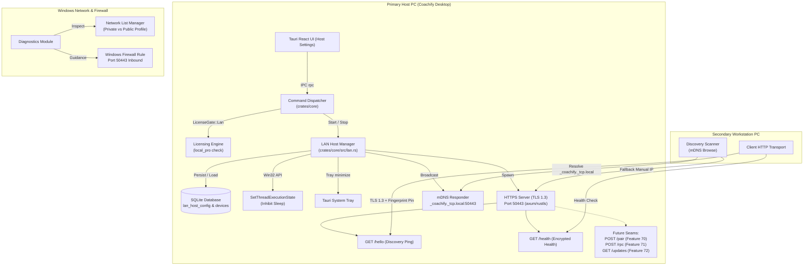
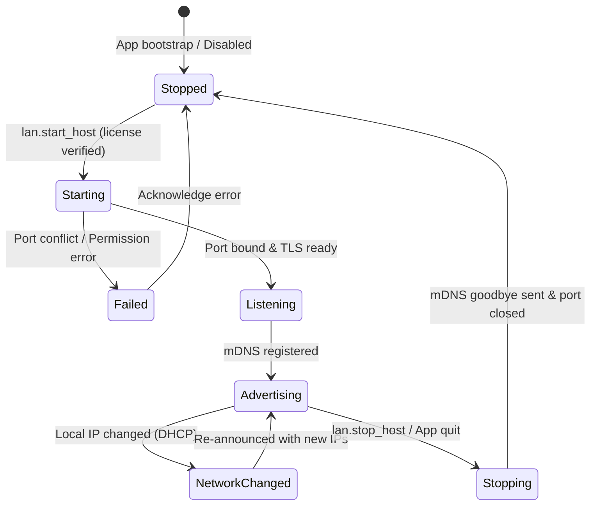

# 0044. LAN Host Service and Discovery

**Date**: 2026-09-26
**Status**: Done
**Scope**: Feature 69 · Slice 13 (LAN Multi PC)

## Summary

Coachify introduces an offline-first, local-network host service that enables a coaching center's primary desktop PC to act as an authoritative host for secondary workstations across the office LAN without internet connectivity. Feature 69 builds the foundational network runtime: an embedded HTTPS listener enforcing TLS 1.3 with a self-signed, pinned X.509 certificate generated on first boot; automatic zero-configuration service advertisement via multicast DNS (mDNS / DNS-SD `_coachify._tcp.local`); unauthenticated discovery pings (`GET /hello`) and encrypted health monitoring (`GET /health`); automated Windows network profile detection (`Private` vs `Public`) with firewall setup guidance; Win32 sleep inhibition (`SetThreadExecutionState`) to prevent host suspension during office hours; and app shell system-tray minimization. Gated by `LicenseGate::Lan`, this feature provides the rock-solid, secure network seam required for workstation pairing (Feature 70) and remote RPC dispatch (Feature 71).

## Structure

This specification covers Feature 69 of Slice 13 (LAN Multi PC):

- [index.md](index.md): Full architectural specification, acceptance criteria, data models, network protocol, Windows platform integration, and build plan for LAN Host Service & Discovery.
- [rationale.md](rationale.md): Architectural context, options considered (TLS 1.3 vs HTTP, mDNS vs UDP/cloud discovery, in-process host vs Windows Service), and design decisions.
- [verify.md](verify.md): Automated integration test suites, manual verification matrix, network failure drills, and firewall diagnostics validation.

## Requirements

**User stories**:
- As a coaching center owner with multiple receptionists and counter clerks, I want my primary office computer to host Coachify across our local Wi-Fi or wired network, so that multiple staff can work concurrently without an internet connection.
- As a counter cashier on a secondary workstation, I want my computer to automatically find the host PC on the network without typing complicated IP addresses, so that I can connect quickly even if the host's IP changed via DHCP.
- As an administrator setting up Coachify, I want the system to warn me if my Windows network is set to "Public" and provide clear guidance to configure Windows Firewall, so that workstations can connect without networking headaches.
- As an owner hosting Coachify, I want the computer to remain awake and the host service to stay active in the system tray when I close the main window, so that front desk operations are never accidentally halted by closing the window or PC sleep.
- As an institution owner, I want all network communication across the coaching center to be strictly encrypted with pinned certificates, so that students on office Wi-Fi cannot sniff sensitive student records, phone numbers, or payments.

**Acceptance criteria**:

- **AC-1: Persistent Host Identity & Pinned TLS 1.3 Certificate Custody**:
  - The core engine generates a cryptographically strong self-signed X.509 v3 certificate and private key (ECDSA P-256 or Ed25519) on initial host initialization.
  - Certificate Subject Alternative Names (SANs) include `localhost`, `127.0.0.1`, `::1`, the Windows NetBIOS/DNS hostname, and all active local IPv4/IPv6 interface addresses.
  - Certificate validity is set to 10 years (3650 days).
  - The certificate's SHA-256 fingerprint (`SHA256:XX:XX:...`) is computed and stored.
  - Key material and certificates are persisted in SQLite (`lan_host_config` table via Migration 0024) and survive host reboots, IP address changes, and database backup/restore operations so workstations retain cryptographic trust without re-pairing.
- **AC-2: License Entitlement Gating (`LicenseGate::Lan`)**:
  - Starting the LAN host listener requires a valid license possessing the `lan_multi_device` capability (tier `local_pro` or active evaluation `trial`).
  - Gated by `LicenseGate::Lan` in the central command dispatcher. If a user on `Coachify Local` (single-PC tier) attempts to enable the host, the dispatcher returns error code `LICENSE_FEATURE_NOT_ENTITLED` with an upgrade prompt.
- **AC-3: High-Performance Pinned TLS 1.3 HTTPS Listener & Port Binding**:
  - The host binds to TCP port `50443` by default (`0.0.0.0:50443`), with configurable port selection (range 1024–65535).
  - Enforces TLS 1.3 (with modern TLS 1.2 fallback cipher suites). Unencrypted plain HTTP connections are rejected at the transport layer.
  - The server runs on a background asynchronous Tokio runtime decoupled from the Tauri UI thread, ensuring zero stuttering in desktop views.
  - Starting and stopping the host listener executes cleanly in under 500 milliseconds.
- **AC-4: Discovery & Pre-Handshake Ping Endpoint (`GET /hello`)**:
  - Exposes an unauthenticated, rate-limited TLS HTTP endpoint at `/hello`.
  - Returns minimal public JSON: `product: "coachify"`, `protocol_version: 1`, `app_version`, `host_id` (matching `devices.id` where `is_host = 1`), `institution_name`, `pairing_open: bool`, and `tls_fingerprint_sha256`.
  - Zero sensitive business data: student records, financial balances, staff identities, and credentials are never exposed on `/hello`.
  - Rate-limited to max 30 requests per minute per source IP to prevent network flooding and scanning abuse.
- **AC-5: Encrypted Host Diagnostics & Health Endpoint (`GET /health`)**:
  - Exposes an encrypted health endpoint at `/health` over TLS.
  - Returns host health status: `status: "healthy" | "degraded"`, `host_id`, `protocol_version: 1`, `database_status: "ok"` (verifying SQLite pool readability), `uptime_seconds`, `active_workstations_count`, `bound_port`, and `server_time_utc`.
  - Serves as the authoritative time check for connecting workstations.
- **AC-6: Zero-Configuration Local Discovery via mDNS (DNS-SD)**:
  - Broadcasts multicast DNS announcements on `224.0.0.251:5353` (IPv4) and `[FF02::FB]:5353` (IPv6) under service type `_coachify._tcp.local`.
  - Service instance name: `Coachify - <Institution Name> (<Hostname>)`.
  - TXT records carry: `host_id=<uuid>`, `proto=1`, `fingerprint=<sha256>`, `inst=<institution_name>`, `ver=<app_version>`, and `pairing=0|1`.
  - Transmits RFC 6762 goodbye packets (TTL = 0) immediately upon graceful host shutdown or application exit.
- **AC-7: Resilient Workstation Discovery Scanner & Manual IP Fallback**:
  - Provides a discovery scanner component that browses for `_coachify._tcp.local` services and resolves host IP, port, and TXT metadata.
  - Manual Fallback: if mDNS multicast is suppressed by router settings (e.g. WiFi client isolation, IGMP snooping), users can manually enter `IP:PORT` or `hostname:PORT`. The client queries `GET /hello` over TLS, verifies `product == "coachify"`, and presents the host.
- **AC-8: Windows Network Profile & Firewall Setup Guidance**:
  - Inspects active Windows network profiles using the Network List Manager / PowerShell.
  - If any active adapter is marked `Public`, warns the operator that Windows Firewall blocks inbound traffic by default, offering guidance and a one-click PowerShell command to switch to `Private`.
  - Checks for the existence of an inbound Windows Firewall rule for port 50443 and outputs the exact command:
    `netsh advfirewall firewall add rule name="Coachify LAN Host" dir=in action=allow protocol=TCP localport=50443 profile=private`.
  - Diagnostics module tests loopback TLS reachability and provides troubleshooting hints for router client isolation.
- **AC-9: Windows Sleep Prevention & System Tray Integration**:
  - When the LAN host is active, calls Win32 `SetThreadExecutionState(ES_CONTINUOUS | ES_SYSTEM_REQUIRED | ES_AWAYMODE_REQUIRED)` to inhibit system sleep and network adapter power-down.
  - Closing the desktop window minimizes the application to the Windows system tray with a notification: "Coachify is running in background as LAN Host".
  - Quitting the application displays a confirmation prompt: "LAN Host is active. Exiting will disconnect paired workstations. Are you sure?".
  - Registry auto-start option (`HKCU\Software\Microsoft\Windows\CurrentVersion\Run`) allows automatic background launch on Windows startup.

## Decision

**Chosen option**: Option 1: Embedded Asynchronous HTTPS (TLS 1.3) Listener with Self-Signed Pinned X.509 Certificate, Native mDNS (DNS-SD) Broadcast, Win32 Sleep Inhibition, and Central Dispatcher License Gating.

We embed a lightweight, high-performance HTTPS service directly into the Coachify desktop core. The host generates a self-signed X.509 certificate with Subject Alternative Names for all local interfaces, persisting the key and cert in SQLite (`lan_host_config`). Workstations discover the host using mDNS (`_coachify._tcp.local`) or direct IP entry, pinning the certificate's SHA-256 fingerprint. Sleep inhibition prevents Windows from suspending the host, and closing the window minimizes to the system tray. License entitlement is strictly enforced by `LicenseGate::Lan`.

**Implementation skills**: `rust-best-practices` (`apollographql/skills`, `.claude/skills/rust-best-practices/`) · `tauri-v2` (`nodnarbnitram/claude-code-extensions`, `.claude/skills/tauri-v2/`) · `shadcn` (`shadcn/ui`, `.claude/skills/shadcn/`) · `tailwind-4-docs` (`lombiq/tailwind-agent-skills`, `.claude/skills/tailwind-4-docs/`) · `tanstack-query` (`tanstack-skills/tanstack-skills`, `.claude/skills/tanstack-query/`) · `vitest` (`antfu/skills`, `.claude/skills/vitest/`)

## Rationale

Reasoning and architectural options: see [rationale.md](rationale.md).

## Feature Design



### Data Model Sketch

Migration `0024_lan_host_service.sql` establishes persistent storage for the host configuration, certificate material, and network settings:

```sql
-- Migration 0024: LAN Host Service and Discovery Configuration

CREATE TABLE IF NOT EXISTS lan_host_config (
    id TEXT PRIMARY KEY, -- 'default'
    is_enabled INTEGER NOT NULL DEFAULT 0 CHECK (is_enabled IN (0, 1)),
    port INTEGER NOT NULL DEFAULT 50443 CHECK (port BETWEEN 1024 AND 65535),
    bind_address TEXT NOT NULL DEFAULT '0.0.0.0',
    tls_cert_pem TEXT NOT NULL,
    tls_key_pem TEXT NOT NULL,
    tls_fingerprint_sha256 TEXT NOT NULL,
    mdns_enabled INTEGER NOT NULL DEFAULT 1 CHECK (mdns_enabled IN (0, 1)),
    auto_start_on_boot INTEGER NOT NULL DEFAULT 0 CHECK (auto_start_on_boot IN (0, 1)),
    prevent_sleep INTEGER NOT NULL DEFAULT 1 CHECK (prevent_sleep IN (0, 1)),
    created_at TEXT NOT NULL,
    updated_at TEXT NOT NULL
);

-- Audit trigger: prevent deletion of host configuration
CREATE TRIGGER IF NOT EXISTS prevent_delete_lan_host_config
BEFORE DELETE ON lan_host_config
BEGIN
    SELECT RAISE(ABORT, 'LAN host configuration record cannot be deleted');
END;
```

### State Transitions



### Protocol & Transport Specification

1. **TLS Configuration**:
   - TLS 1.3 mandatory (with TLS 1.2 fallback using AEAD cipher suites: `TLS_AES_128_GCM_SHA256`, `TLS_AES_256_GCM_SHA384`, `TLS_CHACHA20_POLY1305_SHA256`).
   - Self-signed X.509 v3 certificate generated with `rcgen`.
   - SAN list: `localhost`, `127.0.0.1`, `::1`, Windows hostname, and all active non-loopback IPv4/IPv6 addresses.
   - Fingerprint: uppercase hex SHA-256 with colons (`SHA256:7B:3A:42:...`).
2. **mDNS Service Announcement**:
   - Service Name: `_coachify._tcp.local`
   - Port: `lan_host_config.port` (50443)
   - TXT Records:
     - `host_id`: UUIDv7 of host device
     - `proto`: `"1"`
     - `fingerprint`: SHA-256 fingerprint string
     - `inst`: UTF-8 encoded institution name
     - `ver`: Application semver string (e.g. `"0.1.0"`)
     - `pairing`: `"0"` (or `"1"` during 10-minute pairing window in Feature 70)
3. **HTTP API Endpoints**:
   - `GET /hello`: Discovery & pre-handshake ping (unauthenticated, rate-limited to 30 req/min).
   - `GET /health`: Encrypted host diagnostics and health check.

### API Surface

| Endpoint / Command | Type / Method | Key Inputs | Key Outputs | Auth / Gate | Key Errors |
|---|---|---|---|---|---|
| `lan.get_host_status` | Core RPC Query | None | `LanHostStatus` (`is_running`, `port`, `bound_addresses`, `fingerprint`, `active_workstations`, `network_profile`, `firewall_status`, `mdns_broadcasting`, `license_entitled`) | Session Bearer (`settings.read` or `owner`) | `SESSION_INVALID` |
| `lan.start_host` | Core RPC Mutation | `port` (opt), `bind_address` (opt) | `LanHostStatus` | Session Bearer + `LicenseGate::Lan` + `settings.manage` | `LICENSE_FEATURE_NOT_ENTITLED`, `LAN_PORT_IN_USE`, `LAN_CERT_GENERATION_FAILED` |
| `lan.stop_host` | Core RPC Mutation | None | `LanHostStatus` | Session Bearer + `settings.manage` | `LAN_HOST_NOT_RUNNING` |
| `lan.update_host_config` | Core RPC Mutation | `port`, `bind_address`, `auto_start_on_boot`, `prevent_sleep` | `LanHostStatus` | Session Bearer + `settings.manage` | `INVALID_PORT_RANGE`, `LAN_PORT_IN_USE` |
| `lan.get_firewall_guidance` | Core RPC Query | None | `FirewallGuidance` (`profile`, `is_private`, `rule_exists`, `powershell_command`, `netsh_command`) | Public / Authenticated | None |
| `lan.discover_hosts` | Core RPC Query | `timeout_ms` (opt, default 2000) | `DiscoveredHostList` (`hosts`: list of `host_id`, `name`, `ip`, `port`, `fingerprint`, `app_version`) | Authenticated | `LAN_DISCOVERY_TIMEOUT` |
| `lan.ping_host` | Core RPC Query | `ip`, `port`, `expected_fingerprint` (opt) | `HostPingResult` (`reachable`, `product`, `protocol_version`, `host_id`, `institution_name`, `fingerprint_matched`, `rtt_ms`) | Authenticated | `HOST_UNREACHABLE`, `TLS_FINGERPRINT_MISMATCH` |
| `GET /hello` | HTTP over TLS | None | JSON `HelloResponse` | Public (Unauthenticated, rate-limited) | `429 Too Many Requests` |
| `GET /health` | HTTP over TLS | None | JSON `HealthResponse` | TLS connection | `503 Service Unavailable` (if DB locked) |

### Value Sourcing

| Action / Field | Value Produced / Displayed | Source |
|---|---|---|
| Host Identity (`host_id`) | UUIDv7 | Read from `devices.id` where `is_host = 1` in SQLite |
| Certificate & Key | X.509 v3 PEM & PKCS#8 Key | Generated on first start via `rcgen` and stored in `lan_host_config` |
| Local IPs in SANs | `192.168.x.x`, `10.x.x.x`, etc. | Discovered dynamically via network interface enumeration (`get_if_addrs` or standard socket query) |
| Fingerprint | Hex SHA-256 | Derived from DER encoded certificate bytes |
| Network Profile | `Private` / `Public` | Queried from Windows Network List Manager (NLM) or PowerShell `Get-NetConnectionProfile` |
| Server UTC Time | ISO 8601 UTC timestamp | System real-time clock stamped by host (`jiff::Timestamp::now()`) |

### Key Invariants

1. **Cryptographic Secrecy over Plaintext**: Plain unencrypted HTTP is strictly forbidden on LAN. All network exchanges require TLS 1.3 with certificate pinning.
2. **Zero Sensitive Data on Unauthenticated Pings**: `GET /hello` must never return student names, guardian phones, ledger totals, or user records. It exposes only system protocol metadata and institution display name.
3. **Immutability of Host Identity across Network Swaps**: The `host_id` and TLS certificate remain constant even when DHCP assigns a new local IP to the host computer.
4. **Single Host Writer Authority**: The host PC owns the definitive database and monotonic system clock. Connecting clients never timestamp business transactions or assign student/receipt IDs.
5. **No Ghost Hosting on Expired Licenses**: `LicenseGate::Lan` actively guards host initialization; an expired subscription or downgrading to single-PC tier halts or rejects the host listener.

### Security Model & Threat Analysis

- **LAN Eavesdropping (Students on Coaching Wi-Fi)**:
  - Threat: A tech-savvy student on office Wi-Fi sniffs network packets to steal student records or exams.
  - Defense: Mandatory TLS 1.3 encryption across all LAN endpoints. Self-signed certificate is verified by SHA-256 fingerprint pinning on workstations.
- **Rogue Host Spoofing / Impersonation**:
  - Threat: An attacker runs a fake Coachify host on the same Wi-Fi network to collect cashier logins.
  - Defense: Workstations only connect to hosts whose SHA-256 certificate fingerprint matches the authorized pairing record established during handshake.
- **Denial of Service / Port Flooding**:
  - Threat: Network scans or rogue devices flood the host port with HTTP requests.
  - Defense: Asynchronous connection pooling, strict request timeouts (5 seconds), and sliding window rate limits on `/hello` (30 req/min per IP).
- **Network Interface Exposure**:
  - Threat: Host PC connects to an unsecure public Wi-Fi hotspot (e.g. coffee shop or tethering) and opens LAN access.
  - Defense: Windows network profile detection flags `Public` networks. Windows Firewall rule restricts inbound traffic strictly to `Private` profile.

### Windows Platform Integration

1. **Sleep Inhibition**:
   - Uses `windows-sys` or `winapi` to call `SetThreadExecutionState`:
     `SetThreadExecutionState(ES_CONTINUOUS | ES_SYSTEM_REQUIRED | ES_AWAYMODE_REQUIRED);`
   - Reverts state when host mode is stopped.
2. **System Tray Integration**:
   - Desktop window intercept: when `is_hosting` is true, intercept the `CloseRequested` event in Tauri. Instead of quitting the process, hide the main window and display a system tray balloon: "Coachify is hosting on LAN in the background".
3. **Firewall Rule Management**:
   - App provides a dedicated Firewall Guidance panel in Settings -> LAN Host showing network profile status (`Private` vs `Public`) and a button to copy or execute the required PowerShell rule.

### Critical Test Scenarios

- **Happy Path (Host Initialization & TLS Certificate Generation)**: Initialize LAN host on fresh install; verify X.509 certificate generation, SAN coverage (loopback, hostname, local IPs), SHA-256 fingerprint derivation, and persistence in `lan_host_config`, satisfies **AC-1**, **AC-3**.
- **Entitlement Gating (`LicenseGate::Lan`)**: Attempt to start host on `Coachify Local` (single PC) plan; assert rejection with `LICENSE_FEATURE_NOT_ENTITLED`. Switch license to `Coachify Local Pro`; assert host starts successfully, satisfies **AC-2**.
- **TLS 1.3 Transport & Pinned Fingerprint**: Connect to `https://127.0.0.1:50443/hello` with TLS 1.3 client; assert valid JSON response matching `host_id`, `product == "coachify"`, and certificate fingerprint, satisfies **AC-3**, **AC-4**.
- **Unauthenticated Ping Privacy & Rate Limiting**: Send 35 rapid requests to `/hello`; verify requests 1–30 succeed and expose zero student/ledger data, while requests 31+ receive HTTP 429 Too Many Requests, satisfies **AC-4**.
- **Encrypted Health Check**: Call `GET /health` over TLS; verify `status == "healthy"`, `database_status == "ok"`, and accurate `uptime_seconds`, satisfies **AC-5**.
- **mDNS Service Announcement & Goodbye**: Start host; verify mDNS responder announces `_coachify._tcp.local` with TXT records. Stop host; verify RFC 6762 goodbye packet (TTL=0) is broadcast immediately, satisfies **AC-6**.
- **Workstation Discovery Scanner & Manual IP Fallback**: Launch discovery scanner; verify local host is discovered via mDNS. Simulate multicast suppression; verify manual `IP:50443` entry successfully verifies host over TLS, satisfies **AC-7**.
- **Windows Network Profile Detection**: Query firewall guidance on `Public` network; verify warning banner and exact PowerShell remediation script, satisfies **AC-8**.
- **Sleep Prevention & Close to Tray**: Verify `SetThreadExecutionState` called upon start; verify window close hides window to tray without terminating the Tokio HTTPS listener, satisfies **AC-9**.

## Build Plan

Ordered by the `Tracer Bullet` approach across `crates/core`, `src-tauri`, and `ui/`:

1. **Core Data Model, Certificate Custody & License Gating (`crates/core`)**: Add Migration `0024_lan_host_service.sql` (`lan_host_config`), implement X.509 certificate and private key generation with SANs using `rcgen`, compute SHA-256 fingerprint, store in SQLite, and add `LicenseGate::Lan` enforcement in dispatcher, satisfies **AC-1**, **AC-2**.
2. **Native TLS 1.3 HTTPS Listener, Router & Discovery Endpoints (`crates/core`)**: Build lightweight asynchronous Tokio/rustls HTTPS listener binding to port 50443, implement `GET /hello` (with sliding-window rate limiting) and `GET /health` endpoints, and wire `lan.get_host_status`, `lan.start_host`, `lan.stop_host`, and `lan.update_host_config` RPC commands, satisfies **AC-3**, **AC-4**, **AC-5**.
3. **mDNS Service Broadcaster & Discovery Scanner (`crates/core`)**: Implement DNS-SD responder for `_coachify._tcp.local` broadcasting host TXT metadata and goodbye packets on shutdown, implement client discovery scanner and manual IP fallback ping (`lan.discover_hosts`, `lan.ping_host`), satisfies **AC-6**, **AC-7**.
4. **Windows Platform Services: Network Profile, Firewall, Sleep Inhibition & System Tray (`crates/core`, `src-tauri`, `ui/`)**: Implement Windows Network Profile and firewall inspection (`lan.get_firewall_guidance`), Win32 `SetThreadExecutionState` sleep inhibitor, Tauri system tray minimize on window close, and Settings -> LAN Host management panel in `ui/` matching `design.md`, satisfies **AC-8**, **AC-9**.

## Consequences

**Positive**:
- Establishes a rock-solid, zero-configuration local networking foundation for multi-counter coaching operations without requiring internet connectivity or external cloud servers.
- TLS 1.3 encryption with certificate fingerprint pinning ensures total data privacy even across shared coaching center student Wi-Fi.
- Seamless mDNS discovery paired with manual IP fallback provides foolproof workstation pairing regardless of router quirks.
- Sleep inhibition and system-tray minimization prevent accidental counter stoppages caused by operator window closing or Windows power saving.

**Negative / Tradeoffs**:
- Hosting multiple workstations requires the primary PC to stay powered on during working hours (addressed by sleep inhibition and LAN deployment guide).
- Self-signed certificates require client-side fingerprint pinning since standard browser/OS certificate authorities are not involved.

**Neutral**:
- Adds SQLite Migration `0024_lan_host_service.sql` to `crates/core`.
- Default port 50443 requires an inbound Windows Firewall rule on `Private` networks (guided automatically by the UI).

## Follow-up

- [ ] Complete Feature 70: Workstation pairing handshake with 8-digit PAKE code and device tokens ([docs/scope/lan.md](../../scope/lan.md)).
- [ ] Complete Feature 71: Workstation client mode with remote RPC forwarding over pinned TLS ([docs/scope/lan.md](../../scope/lan.md)).
- [ ] Complete Feature 72: LAN host update mirror for zero-internet client workstation updates ([docs/scope/lan.md](../../scope/lan.md)).
