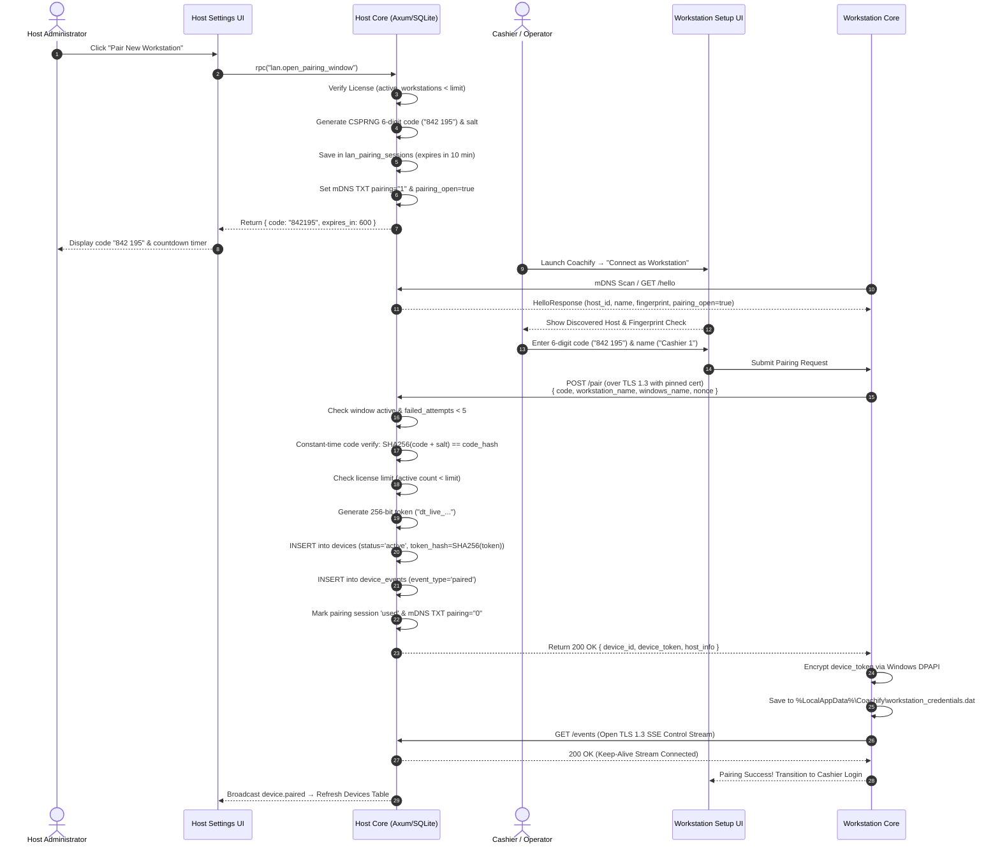
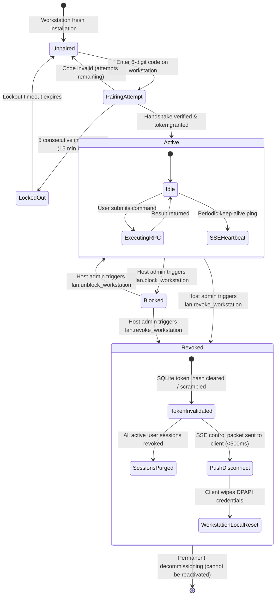
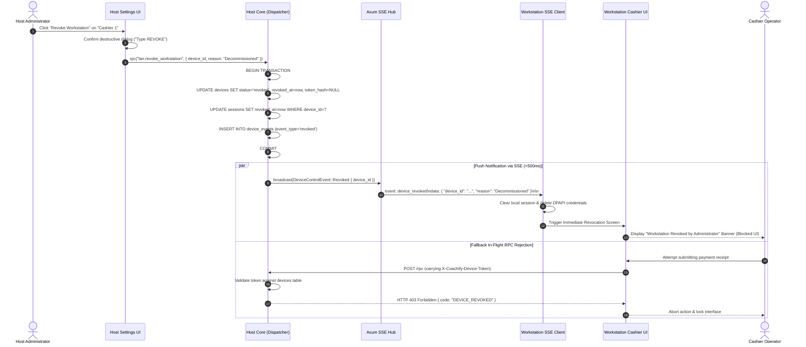

# 0045. Workstation Pairing and Device Management

**Date**: 2026-09-26
**Status**: Specified / Ready for Development
**Scope**: Feature 70 · Slice 13 (LAN Multi PC)

## Summary

Coachify enables multi-counter coaching center operations across an offline local network without internet connectivity. Building directly upon the secure network runtime established in Spec 0044 (LAN Host Service & Discovery, Feature 69), **Feature 70** delivers the cryptographic pairing handshake and authoritative device lifecycle management. Secondary workstation PCs (e.g. reception desks, cashier counters, coordinator stations) pair with the primary host PC via an ephemeral, high-entropy 6-digit numeric code presented visually on the host operator's screen. 

Upon mutual validation over a pinned TLS 1.3 transport, the host issues a cryptographically secure, 256-bit persistent device token (`Bearer dt_...`), recorded in the host's authoritative device registry (`devices` table via SQLite Migration 0025). Connecting workstations persist this credential locally using Windows Data Protection API (DPAPI). The coaching center owner retains total administrative governance from **Settings → Devices**: inspecting connected hardware, renaming friendly workstation labels, monitoring real-time connectivity and active staff sessions, enforcing license workstation quotas (`Coachify Local Pro` seat limits), temporarily blocking suspicious machines, and permanently revoking retired or compromised workstations. 

Revocation triggers an immediate dual-barrier disconnect: an active Server-Sent Events (SSE) control channel forcibly severs the client connection and purges local credentials in under 500 milliseconds, while transport-level device-token validation instantaneously rejects any incoming or in-flight RPC commands with `DEVICE_REVOKED`.

## Structure

This specification covers Feature 70 of Slice 13 (LAN Multi PC):

- [index.md](index.md): Full architectural specification, acceptance criteria, data models, network protocol, state transitions, API surface, security model, and build plan for Workstation Pairing & Device Management.
- [rationale.md](rationale.md): Architectural context, options considered (6-digit OTP vs pre-shared keys vs QR-only vs cloud pairing; push SSE vs polling disconnect; DPAPI vs unencrypted token storage; seat enforcement models), and design decisions.
- [verify.md](verify.md): Automated integration test suites, manual verification matrix, security brute-force drills, revocation speed benchmarks, and acceptance criteria coverage mapping.

## Requirements

**User stories**:
- As a coaching center owner, I want to pair a new cashier computer by clicking "Pair New Workstation" on my primary host PC and typing the displayed 6-digit code on the cashier PC, so that setup takes less than 30 seconds without complex networking or password sharing.
- As a front-desk cashier, I want my computer to stay paired across application restarts and PC reboots, so that I only have to complete pairing once and can immediately log in each morning.
- As an administrator, I want to see an inventory of all paired workstations in Settings with their friendly names, computer hostnames, IP addresses, and online status, so that I know exactly which machines have access to our student records.
- As an owner, I want to rename a computer to "Counter 1 - Reception" or "Cashier Desk 2", so that audit logs and cashier sessions clearly identify where transactions occurred.
- As an owner whose staff member leaves or whose laptop is decommissioned, I want to revoke that workstation immediately with one click, so that the machine is disconnected instantly, its device token is permanently invalidated, and its license slot is freed up for a replacement PC.
- As an owner, I want the system to enforce our license workstation quota cleanly, warning me when seats are full and preventing unauthorized computer sprawl.

**Acceptance criteria**:

- **AC-1: Ephemeral 6-Digit Pairing Code & Anti-Brute-Force Window**:
  - The host operator initiates pairing via `lan.open_pairing_window`, which generates a cryptographically random 6-digit numeric code (range `100000`–`999999`) using CSPRNG.
  - The code is valid for exactly 10 minutes (600 seconds) from generation.
  - The host exposes `pairing_open: true` on `GET /hello` and sets mDNS TXT `pairing=1` while the window is active.
  - The host UI displays the code in large, accessible typography alongside a live countdown timer and QR code representation.
  - Brute-force protection: The host tracks failed pairing attempts. Upon 5 consecutive incorrect code submissions, the host locks the pairing window immediately for 15 minutes, aborts the active session, resets mDNS `pairing=0`, and logs a security audit event (`security.pairing_brute_force_locked`).
- **AC-2: Mutual Cryptographic Handshake over Pinned TLS 1.3**:
  - Pairing requests are submitted to `POST /pair` exclusively over the host's TLS 1.3 listener. Plain HTTP pairing attempts are rejected at the transport layer.
  - The workstation client verifies the host's X.509 SHA-256 certificate fingerprint against the fingerprint discovered via mDNS or explicitly approved by the operator.
  - The workstation submits: `pairing_code`, client-generated `client_nonce`, `workstation_name`, `windows_name`, `os_version`, and `app_version`.
  - The host verifies the pairing code hash using constant-time comparison (`subtle::ConstantTimeEq`).
  - Codes are strictly single-use: upon successful pairing, the session transitions to `used` and the pairing window is closed immediately.
- **AC-3: High-Entropy Persistent Device Tokens & Windows DPAPI Storage**:
  - Upon successful code verification, the host generates a 256-bit cryptographically secure device token prefixed with `dt_` (e.g. `dt_0192e4...`).
  - The host computes `SHA256(device_token)` and persists it in `devices.token_hash`. The raw plaintext token is never written to disk on the host.
  - The host returns the raw device token, assigned `device_id` (UUIDv7), `institution_name`, and host identity to the client.
  - The workstation securely stores the device token, host certificate fingerprint, and host ID using Windows Data Protection API (DPAPI via `CryptProtectData`) in `%LocalAppData%\Coachify\workstation_credentials.dat`.
  - On subsequent app launches, the workstation transparently decrypts the token via DPAPI and authenticates to the host without requiring re-pairing.
- **AC-4: Commercial License Workstation Limit Enforcement (`workstation_limit`)**:
  - Pairing requires an active license with the `lan_multi_device` capability (tier `local_pro` or active evaluation `trial`).
  - The host strictly checks the license's `workstation_limit` (e.g., 1 for Trial, 2 for Standard, 5 for Plus, custom for Enterprise).
  - If `active_workstations >= workstation_limit`, the host rejects `lan.open_pairing_window` and `POST /pair` with error code `LAN_WORKSTATION_LIMIT_REACHED` and displays clear upgrade instructions.
  - Revoking an existing workstation immediately decrements `active_workstations`, freeing up a slot for a new device.
- **AC-5: Authoritative Host Workstation Registry (`devices` Table via Migration 0025)**:
  - SQLite Migration `0025_workstation_pairing.sql` enhances the `devices` table with `ip_address`, `os_version`, `blocked_at`, `revoked_at`, and `revocation_reason`, and introduces `lan_pairing_sessions` and `device_events`.
  - Query `lan.list_workstations` returns all registered devices, their status (`active`, `blocked`, `revoked`), last seen timestamp, IP address, and active staff session count.
  - The host continuously tracks workstation liveness: any device communicating within the last 30 seconds is marked `online`.
- **AC-6: Workstation Label Management & Friendly Renaming**:
  - The host operator can update a workstation's human-friendly name via `lan.rename_workstation(device_id, new_name)`.
  - Validation requires `new_name` to be between 1 and 60 characters, trimmed of leading/trailing whitespace.
  - Renaming writes an immutable audit record to `device_events` (`event_type = 'renamed'`) and reflects immediately across all cashier receipts and session logs.
- **AC-7: Workstation Blocking & Temporary Suspension**:
  - The host operator can temporarily suspend a workstation via `lan.block_workstation(device_id, reason)`.
  - Transitions `devices.status` to `blocked` and timestamps `blocked_at`.
  - Immediately revokes all active user sessions associated with that device (`UPDATE sessions SET revoked_at = now WHERE device_id = ?`).
  - Unblocking via `lan.unblock_workstation(device_id)` restores status to `active` (subject to workstation limit availability) without requiring re-pairing.
- **AC-8: Permanent Workstation Revocation & Immediate Disconnection**:
  - The host operator can permanently decommission a workstation via `lan.revoke_workstation(device_id, reason)`.
  - Transitions `devices.status` to `revoked`, sets `revoked_at = now`, records `revocation_reason`, and clears or scrambles `token_hash` so the device token can never be authenticated again.
  - Immediately invalidates all active user sessions for that device.
  - Disconnection SLA: The workstation UI must terminate its active session and transition to the "Access Revoked" screen in under **500 milliseconds**.
- **AC-9: Real-Time SSE Control Stream & Instant Push Severance**:
  - The host HTTPS listener exposes an authenticated Server-Sent Events endpoint: `GET /events` requiring header `X-Coachify-Device-Token`.
  - Connected workstations maintain a persistent TLS 1.3 SSE connection for real-time control events and heartbeat pings.
  - When `lan.block_workstation` or `lan.revoke_workstation` is executed, the host broadcasts a targeted `device.revoked` or `device.blocked` event down the workstation's SSE pipe.
  - The workstation event handler receives the message, clears in-memory session tokens, purges local DPAPI credentials, and forces an immediate redirect to an unauthenticated disconnection banner.
  - Defense in depth: Every subsequent HTTP RPC request carrying a blocked or revoked token is rejected at the transport layer with HTTP 403 Forbidden (`DEVICE_REVOKED` / `DEVICE_BLOCKED`).
- **AC-10: Security Audit Trail & Event Immutability**:
  - Every device lifecycle transition (`paired`, `renamed`, `blocked`, `unblocked`, `revoked`, `token_reissued`) is logged to the `device_events` table and central `audit_log`.
  - Audit records capture `device_id`, `event_type`, `actor_user_id`, remote IP address, machine hostname, and structured JSON metadata.
  - Historical device events cannot be modified or deleted.

## Decision

**Chosen option**: Option 1: Pinned TLS 1.3 Transport with Ephemeral 6-Digit CSPRNG Code Handshake, 256-Bit Persistent Bearer Device Tokens Stored via Windows DPAPI, Authoritative SQLite Device Registry, Real-Time SSE Control Channel for Sub-500ms Revocation Disconnect, and Central Dispatcher License Gating (`LicenseGate::Lan`).

We implement workstation pairing entirely within the Coachify local network architecture. The host generates a 10-minute 6-digit numeric pairing code. Workstations discover the host via mDNS (`_coachify._tcp.local`) or direct IP, verify the pinned SHA-256 certificate fingerprint, and submit the code over TLS 1.3. Upon validation, the host issues a 256-bit device token and records the device in `devices`. The client encrypts the token using Windows DPAPI. Device revocation immediately pushes a `device.revoked` control event across an open SSE connection while simultaneously nullifying the token in SQLite, guaranteeing immediate disconnection. License workstation seats are strictly governed by `workstation_limit`.

**Implementation skills**: `rust-best-practices` (`apollographql/skills`, `.claude/skills/rust-best-practices/`) · `tauri-v2` (`nodnarbnitram/claude-code-extensions`, `.claude/skills/tauri-v2/`) · `shadcn` (`shadcn/ui`, `.claude/skills/shadcn/`) · `tailwind-4-docs` (`lombiq/tailwind-agent-skills`, `.claude/skills/tailwind-4-docs/`) · `tanstack-query` (`tanstack-skills/tanstack-skills`, `.claude/skills/tanstack-query/`) · `vitest` (`antfu/skills`, `.claude/skills/vitest/`)

## Rationale

Reasoning and architectural options: see [rationale.md](rationale.md).

## Feature Design

### System Architecture & Communication Topology

```mermaid
flowchart TD
    subgraph HostPC["Primary Host PC (Coachify Desktop)"]
        H_UI["Host UI: Settings → Devices"] -->|IPC rpc| H_DISP["Command Dispatcher<br/>(crates/core)"]
        H_DISP -->|LicenseGate::Lan| H_LIC["Licensing Engine<br/>(workstation_limit check)"]
        H_DISP -->|Open / Close Window| H_PAIR["Pairing Manager<br/>(lan_pairing_sessions)"]
        H_DISP -->|Rename / Block / Revoke| H_DEVMGR["Device Registry Manager<br/>(devices table)"]
        
        H_DEVMGR --> DB[(SQLite Database<br/>Migration 0025)]
        H_DEVMGR -->|Push Disconnect| H_BUS["SSE Broadcast Hub<br/>(tokio::sync::broadcast)"]
        
        H_HTTPS["Axum HTTPS Listener (TLS 1.3)<br/>Port 50443"] --> H_PAIR
        H_HTTPS --> H_BUS
        H_HTTPS --> H_HELLO["GET /hello (pairing_open: bool)"]
        H_HTTPS --> H_PAIR_EP["POST /pair (6-digit Handshake)"]
        H_HTTPS --> H_SSE_EP["GET /events (Real-Time Control)"]
    end

    subgraph WorkstationPC["Secondary Workstation PC (Tauri 2 Client)"]
        WS_UI["Workstation UI<br/>(Setup Wizard / Login Screen)"] -->|Tauri State| WS_CLIENT["LAN Client Core"]
        WS_SCAN["Discovery Scanner (mDNS)"] -->|Discover Host| WS_CLIENT
        WS_CLIENT -->|Pinned Fingerprint Check| WS_TRANSPORT["TLS 1.3 Transport (reqwest/rustls)"]
        
        WS_TRANSPORT -->|1. POST /pair (6-Digit Code)| H_PAIR_EP
        WS_TRANSPORT -->|2. Receive Device Token| WS_DPAPI["Windows DPAPI<br/>(CryptProtectData)"]
        WS_DPAPI --> WS_CREDS[("%LocalAppData%\\Coachify\\<br/>workstation_credentials.dat")]
        
        WS_TRANSPORT -->|3. Persistent SSE Stream| H_SSE_EP
        H_BUS -.->|Instant Disconnect Event| WS_TRANSPORT
        WS_TRANSPORT -.->|Trigger Logout & Lockout| WS_UI
    end
```

### Data Model (SQLite Migration 0025)

Migration `0025_workstation_pairing.sql` enhances the existing `devices` table (first defined in Migration 0007), introduces `lan_pairing_sessions` for short-lived handshake management, and adds `device_events` for immutable audit logging:

```sql
-- Migration 0025: Workstation Pairing and Device Management

-- 1. Extend devices table with LAN IP, OS metadata, and revocation fields
ALTER TABLE devices ADD COLUMN ip_address TEXT;
ALTER TABLE devices ADD COLUMN os_version TEXT;
ALTER TABLE devices ADD COLUMN blocked_at TEXT;
ALTER TABLE devices ADD COLUMN revoked_at TEXT;
ALTER TABLE devices ADD COLUMN revocation_reason TEXT;

-- Index for fast status and token lookups
CREATE INDEX IF NOT EXISTS idx_devices_status ON devices(status);
CREATE INDEX IF NOT EXISTS idx_devices_last_seen ON devices(last_seen_at DESC);

-- 2. Ephemeral pairing sessions table (managed by host)
CREATE TABLE IF NOT EXISTS lan_pairing_sessions (
    id TEXT PRIMARY KEY, -- UUIDv7
    code_hash TEXT NOT NULL, -- SHA256(code || ':' || salt)
    salt TEXT NOT NULL,      -- 16-byte random hex salt
    expires_at TEXT NOT NULL,
    failed_attempts INTEGER NOT NULL DEFAULT 0,
    status TEXT NOT NULL DEFAULT 'pending' 
        CHECK (status IN ('pending', 'used', 'expired', 'cancelled', 'locked')),
    created_by_user_id TEXT NOT NULL REFERENCES users(id),
    paired_device_id TEXT REFERENCES devices(id),
    created_at TEXT NOT NULL,
    updated_at TEXT NOT NULL
);

CREATE INDEX IF NOT EXISTS idx_pairing_lookup 
    ON lan_pairing_sessions(status, expires_at);

-- 3. Immutable device audit events table
CREATE TABLE IF NOT EXISTS device_events (
    id TEXT PRIMARY KEY, -- UUIDv7
    device_id TEXT NOT NULL REFERENCES devices(id) ON DELETE CASCADE,
    event_type TEXT NOT NULL 
        CHECK (event_type IN ('paired', 'renamed', 'blocked', 'unblocked', 'revoked', 'token_reissued')),
    actor_user_id TEXT REFERENCES users(id),
    remote_ip TEXT,
    details_json TEXT NOT NULL DEFAULT '{}',
    created_at TEXT NOT NULL
);

CREATE INDEX IF NOT EXISTS idx_device_events_device 
    ON device_events(device_id, created_at DESC);

-- Prevent manual update or deletion of immutable device events
CREATE TRIGGER IF NOT EXISTS trg_prevent_modify_device_events
BEFORE UPDATE ON device_events
BEGIN
    SELECT RAISE(ABORT, 'device_events records are append-only and cannot be modified');
END;

CREATE TRIGGER IF NOT EXISTS trg_prevent_delete_device_events
BEFORE DELETE ON device_events
BEGIN
    SELECT RAISE(ABORT, 'device_events records cannot be deleted');
END;
```

### Pairing Handshake Sequence Diagram



### Device Lifecycle State Machine



### Revocation & Immediate Disconnection Sequence Diagram



### API Surface

#### Host Core RPC Commands (Internal Dispatcher)

| Command Name | Kind | Auth Requirement | License Gate | Key Inputs | Key Outputs | Key Errors |
|---|---|---|---|---|---|---|
| `lan.open_pairing_window` | Mutation | Permission(`settings.manage`) | `LicenseGate::Lan` | `duration_seconds` (opt, default 600) | `PairingWindowInfo` (`code`, `expires_at`, `expires_in_seconds`, `host_fingerprint`) | `LAN_HOST_NOT_RUNNING`, `LAN_WORKSTATION_LIMIT_REACHED`, `LAN_PAIRING_ALREADY_OPEN` |
| `lan.close_pairing_window` | Mutation | Permission(`settings.manage`) | `LicenseGate::None` | None | `SuccessResponse` | `LAN_PAIRING_NOT_OPEN` |
| `lan.list_workstations` | Read | Authenticated | `LicenseGate::None` | None | `WorkstationListResponse` (`devices`: list, `quota`: summary) | None |
| `lan.get_workstation` | Read | Authenticated | `LicenseGate::None` | `device_id` (UUIDv7) | `WorkstationDetail` (`device`, `recent_events`, `active_sessions`) | `DEVICE_NOT_FOUND` |
| `lan.rename_workstation` | Mutation | Permission(`settings.manage`) | `LicenseGate::None` | `device_id`, `new_name` (1–60 chars) | `WorkstationSummary` | `DEVICE_NOT_FOUND`, `INVALID_DEVICE_NAME` |
| `lan.block_workstation` | Mutation | Permission(`settings.manage`) | `LicenseGate::None` | `device_id`, `reason` (string) | `WorkstationSummary` | `DEVICE_NOT_FOUND`, `DEVICE_ALREADY_BLOCKED`, `CANNOT_BLOCK_HOST` |
| `lan.unblock_workstation` | Mutation | Permission(`settings.manage`) | `LicenseGate::Lan` | `device_id` | `WorkstationSummary` | `DEVICE_NOT_FOUND`, `DEVICE_NOT_BLOCKED`, `LAN_WORKSTATION_LIMIT_REACHED` |
| `lan.revoke_workstation` | Mutation | Permission(`settings.manage`) | `LicenseGate::None` | `device_id`, `reason` (string) | `WorkstationSummary` | `DEVICE_NOT_FOUND`, `DEVICE_ALREADY_REVOKED`, `CANNOT_REVOKE_HOST` |

#### Host Network HTTP Endpoints (Axum TLS 1.3 Server)

| Endpoint | Method | Security / Auth | Request Headers | Request Body | Response Body | Status Codes |
|---|---|---|---|---|---|---|
| `/pair` | `POST` | TLS 1.3 + Pinned Cert + Active Window + Rate Limiting | `Content-Type: application/json` | `PairRequest` (`pairing_code`, `workstation_name`, `windows_name`, `os_version`, `app_version`, `client_nonce`) | `PairSuccessResponse` (`device_id`, `device_token`, `institution_name`, `host_device_id`) | `200 OK`, `400 Bad Request`, `401 Unauthorized` (`LAN_PAIRING_CODE_INVALID`), `403 Forbidden` (`LAN_WORKSTATION_LIMIT_REACHED`), `423 Locked` (`LAN_PAIRING_LOCKED`), `429 Too Many Requests` |
| `/events` | `GET` | TLS 1.3 + Bearer Device Token | `X-Coachify-Device-Token: <token>` | None | Server-Sent Events stream: `event: device_revoked`, `event: device_blocked`, `event: heartbeat` | `200 OK` (SSE Stream), `401 Unauthorized`, `403 Forbidden` |

### Value Sourcing

| Field / Output | Format / Type | Authoritative Source |
|---|---|---|
| Pairing Code | 6 digits numeric (`"100000"`–`"999999"`) | CSPRNG `rand::thread_rng().gen_range(100_000..=999_999)` |
| Code Hash | 64-char Hex SHA-256 | `sha2::Sha256::digest(format!("{}:{}", code, salt))` |
| Pairing Salt | 32-char Hex string (16 bytes) | CSPRNG random bytes hex-encoded |
| Device Token | `dt_` + 32-byte Base64URL string | CSPRNG random bytes |
| Token Hash | 64-char Hex SHA-256 | `sha2::Sha256::digest(device_token)` |
| `device_id` | UUIDv7 string | Generated on host using `uuid::Uuid::now_v7()` |
| Workstation Hostname | Windows NetBIOS string | Provided by workstation via `whoami::fallible::hostname()` |
| Client Remote IP | IPv4 / IPv6 string | Extracted from Axum `ConnectInfo<SocketAddr>` |
| Disconnect Timestamp | ISO 8601 UTC timestamp | Host system monotonic UTC clock (`jiff::Timestamp::now()`) |
| Workstation Limit | Integer | Decoded from license envelope payload `limits.workstations` |

### Key Invariants

1. **Host-Only Creation Authority**: The primary host PC is the single authority for generating pairing codes, issuing device tokens, and recording devices. Workstations cannot self-register or issue tokens.
2. **Plaintext Secrets Never Persisted on Host**: The host stores only `code_hash` for pairing codes and `token_hash` for device tokens. Plaintext pairing codes and tokens exist only in memory during the transaction.
3. **Strict Single-Use Codes**: A pairing code transitions to `used` immediately upon the first successful validation and can never be accepted again.
4. **Permanent Revocation Irreversibility**: A revoked workstation transitions to `revoked`, its `token_hash` is permanently cleared/scrambled, and it can never reconnect with the same credential. Re-enrolling requires an entirely fresh pairing handshake as a new device.
5. **Sub-500ms Disconnection Guarantee**: When a workstation is revoked or blocked, the active SSE control channel must deliver the disconnection event to the client process within 500 milliseconds.
6. **Hard Workstation Limit Enforced**: Active workstation count (`is_host = 0 AND status = 'active'`) can never exceed the license's `workstation_limit`. If the limit is reached, pairing must be rejected before generating or accepting a code.
7. **Host Protection Invariant**: The host computer (`is_host = 1`) can never be blocked, revoked, or renamed via workstation management commands (`CANNOT_BLOCK_HOST`, `CANNOT_REVOKE_HOST`).

### Security Model & Threat Analysis

- **Threat 1: Eavesdropping on 6-Digit Pairing Code over Wi-Fi**:
  - *Vector*: An attacker or curious student on office Wi-Fi sniffs the network while pairing is occurring.
  - *Mitigation*: The entire pairing transaction occurs inside an encrypted TLS 1.3 tunnel. Plain HTTP is refused. The code is never broadcast or exposed in mDNS TXT records.
- **Threat 2: Brute-Forcing the 6-Digit Code**:
  - *Vector*: An attacker writes an automated script to spray all $10^6$ possible 6-digit codes against `POST /pair`.
  - *Mitigation*: Triple-layered defense:
    1. Pairing window is closed by default. Requests submitted while `pairing_open = false` fail immediately.
    2. Window lifetime is strictly 10 minutes.
    3. Host enforces a hard cap of 5 failed attempts per pairing session. On the 5th failure, the window locks for 15 minutes, aborts the session, resets mDNS, and logs a security alert.
- **Threat 3: Stolen Laptop / Workstation Storage Extraction**:
  - *Vector*: A discarded, lost, or stolen workstation laptop has its SSD inspected for authentication credentials.
  - *Mitigation*: Workstation device tokens are encrypted on disk using Windows Data Protection API (DPAPI via `CryptProtectData`). The ciphertext is tied to the local Windows machine account credentials and cannot be decrypted on another PC. Furthermore, the host owner can click "Revoke" on the host PC at any time, instantly nullifying the token on the server.
- **Threat 4: Rogue Host Impersonation (Evil Twin)**:
  - *Vector*: An attacker runs a fake Coachify host on the local Wi-Fi with the same institution name.
  - *Mitigation*: The workstation pins the host's X.509 SHA-256 certificate fingerprint discovered via mDNS and confirms it visually against the fingerprint displayed on the host screen.
- **Threat 5: Replay Attacks on Device Tokens**:
  - *Vector*: An attacker captures network traffic hoping to replay authorization headers.
  - *Mitigation*: TLS 1.3 encrypts all headers (`X-Coachify-Device-Token`) in transit, eliminating wire interception. Device tokens are tied to client TLS connections and verified against the database.
- **Threat 6: Clock Skew & Tampering**:
  - *Vector*: Workstation modifies its local system clock to extend session lifetime or bypass timeouts.
  - *Mitigation*: All pairing code expiration, session duration, and revocation timestamps are evaluated strictly against the host PC's authoritative system clock.

### Windows Platform Integration

1. **Credential Custody via Windows DPAPI**:
   - On Windows workstations, device credentials must never be stored in plaintext `.json` or `.txt`.
   - The workstation client wraps credentials using the Win32 `CryptProtectData` API:
     ```rust
     // Win32 DPAPI Encryption Pattern
     pub fn encrypt_workstation_secret(data: &[u8]) -> Result<Vec<u8>, DpapiError> {
         #[cfg(windows)]
         {
             use windows_sys::Win32::Security::Cryptography::{CryptProtectData, CRYPTPROTECT_UI_FORBIDDEN, DATA_BLOB};
             // Encrypts using current user + machine DPAPI key
         }
     }
     ```
   - Saved path: `%LocalAppData%\Coachify\workstation_credentials.dat`.
   - Provides seamless re-login for valid Windows users while preventing offline disk theft exploits.
2. **Machine Name & Hostname Resolution**:
   - Workstation automatically reports its Windows Computer Name (NetBIOS) via `whoami::fallible::hostname()` to prepopulate the device registration.

### UI & Design System Integration

Complies strictly with `design.md` (warm editorial aesthetic, maximalist product bar, strict token values in CSS, and zero generic boilerplate):

1. **Host PC: Settings → Devices (সেটিংস → ডিভাইস ও ওয়ার্কস্টেশন)**:
   - **Workstation Seat Quota Card**:
     - Displays: `"Active Workstations: 2 of 5 seats used (Coachify Local Pro)"`.
     - Visual progress meter with subtle pulse when approaching capacity.
     - Warning banner if at limit with link to Customer Portal.
   - **Primary Action: "Pair New Workstation" Button**:
     - Opens Pairing Modal:
       - Large, segmented 6-digit code: `839  214` in font-mono tabular digits with high visual contrast.
       - Visual copy button with tooltip feedback.
       - Animated countdown progress bar (10:00 → 0:00).
       - Host TLS SHA-256 Fingerprint display for cross-verification.
       - Live pulsing connection indicator: *"Listening for workstation on local network..."*.
       - Audio cue & confetti animation upon successful pairing confirmation.
   - **Devices Table**:
     - Columns: Device Label & Windows Name, Local IP Address, Status Badge (`Active` emerald, `Blocked` amber, `Revoked` muted gray), Paired Date, Last Seen (live relative timestamp), Active Sessions Count, Actions Menu.
     - Actions Dropdown:
       - **Rename**: Opens modal to customize friendly label (e.g. "Counter 2 - Fees Desk").
       - **Temporarily Block**: Opens confirmation modal explaining that all active staff sessions on this PC will pause.
       - **Unblock**: Restores device status.
       - **Revoke**: High-friction destructive confirmation requiring typing `"REVOKE"` to prevent accidental cashier cutoffs.
   - **Device Activity Drawer**:
     - Side drawer showing chronological audit history from `device_events` (pairing, renaming, blocking, IP changes).

2. **Workstation PC: Setup Wizard & Connection Screen**:
   - **Mode Selection**: "Run as Secondary Workstation (কানেক্ট করুন ওয়ার্কস্টেশন হিসেবে)".
   - **Discovered Host Card**:
     - Displays detected institution name, host PC name, IP address, and status badge (`Ready to Pair` vs `Pairing Window Closed`).
     - Manual IP / Port input fallback for isolated networks.
   - **Host Fingerprint Cross-Check**:
     - Compares detected fingerprint with host monitor.
   - **6-Digit Pairing Code Input**:
     - 6 segmented OTP input fields with auto-focus, paste handling, and backspace navigation.
     - Friendly device label field (defaults to Windows Computer Name).
   - **Pairing Feedback & Error Handling**:
     - Inline humanized errors: *"Pairing window is not open on the host PC"*, *"Invalid code. 3 attempts remaining"*, *"Workstation limit reached on host"*.
   - **Instant Transition**:
     - Smooth cross-fade to the standard Coachify Login Screen upon handshake completion.

3. **Bilingual Localization (English & Bengali)**:
   - All status labels, modal warnings, and audit events provide complete translations in `locales/en.json` and `locales/bn.json` per Spec 0038.

## Build Plan

Follows the strict `Tracer Bullet` approach, proving an end-to-end slice across `crates/core`, `src-tauri`, and `ui/`:

1. **Step 1: SQLite Migration 0025 & Core Domain Models (`crates/core`)**:
   - Create Migration `migrations/0025_workstation_pairing.sql`.
   - Update `devices` table schema and add `lan_pairing_sessions` and `device_events`.
   - Implement Rust domain types in `crates/core/src/lan.rs` (`LanPairingSession`, `DeviceEvent`, `WorkstationSummary`, `PairRequest`, `PairSuccessResponse`).
   - Add plain SQL repository queries for device CRUD, satisfies **AC-4**, **AC-5**, **AC-10**.
2. **Step 2: 6-Digit Pairing Engine & Anti-Brute-Force Manager (`crates/core`)**:
   - Implement `lan::open_pairing_window`, CSPRNG 6-digit code generator, salt derivation, and SHA-256 hashing.
   - Implement expiration watchdog and 5-attempt brute-force lockout logic.
   - Update host mDNS TXT record (`pairing=1` / `pairing=0`) and `GET /hello` response state, satisfies **AC-1**.
3. **Step 3: `POST /pair` Endpoint & Device Token Issuance (`crates/core`)**:
   - Add `POST /pair` route to the Axum HTTPS listener.
   - Verify code using constant-time comparison, enforce `workstation_limit`, generate 256-bit device token, hash and persist in `devices`.
   - Write audit log entry to `device_events`, satisfies **AC-2**, **AC-3**, **AC-4**.
4. **Step 4: Device Registry Management RPC Commands (`crates/core`)**:
   - Wire `lan.list_workstations`, `lan.rename_workstation`, `lan.block_workstation`, `lan.unblock_workstation`, and `lan.revoke_workstation` in dispatcher.
   - Implement session cascading revocation in `sessions` table upon block or revoke.
   - Guard workstation unblocking with `workstation_limit` check, satisfies **AC-5**, **AC-6**, **AC-7**, **AC-8**.
5. **Step 5: Real-Time SSE Control Channel & Instant Revocation Push (`crates/core`, `src-tauri`)**:
   - Add `GET /events` SSE route to Axum listener validating `X-Coachify-Device-Token`.
   - Implement `tokio::sync::broadcast` control hub.
   - Broadcast `device_revoked` and `device_blocked` events on administrative actions.
   - Enforce transport-level rejection in core request pipeline when device status != `'active'`, satisfies **AC-8**, **AC-9**.
6. **Step 6: Workstation DPAPI Credential Storage & Client Flow (`crates/core`, `src-tauri`)**:
   - Implement Windows DPAPI credential manager for workstation token persistence (`workstation_credentials.dat`).
   - Implement client pairing handshake routine and background SSE event listener with sub-500ms disconnect handler, satisfies **AC-3**, **AC-9**.
7. **Step 7: UI & Design System Implementation (`ui/`)**:
   - Build Settings → Devices management panel with seat quota card, device table, and audit drawer.
   - Build "Pair New Workstation" modal with 6-digit code display and countdown timer.
   - Build Workstation Setup Wizard onboarding flow with 6-digit OTP input and feedback.
   - Add complete English and Bengali localization strings, satisfies **AC-1**, **AC-5**, **AC-6**, **AC-7**, **AC-8**.

## Consequences

**Positive**:
- Empowers coaching centers to scale counter operations across multiple computers with zero IT friction, zero complex passwords, and zero internet dependency.
- 6-digit code handshake is familiar, lightning-fast, and human-friendly, yet cryptographically backed by TLS 1.3, pinned certificates, and brute-force lockouts.
- DPAPI credential persistence eliminates repetitive daily pairing, while owner revocation provides instant, deterministic control over lost or retired PCs.
- Commercial license boundaries (`workstation_limit`) are strictly protected at the database and network layers.

**Negative / Tradeoffs**:
- Workstations must be on the same local network subnet as the host to discover and pair (standard for office Wi-Fi/LAN setups; manual IP fallback is provided for complex topologies).
- Windows DPAPI locks credentials to the specific Windows user profile on that hardware, requiring re-pairing if the workstation user account is recreated.

**Neutral**:
- Adds SQLite Migration `0025_workstation_pairing.sql`.
- Adds an active SSE connection per workstation for real-time control (negligible memory and network overhead on LAN).

## Follow-up

- [ ] Complete Feature 71: LAN workstation client mode & RPC transport ([docs/scope/lan.md](../../scope/lan.md)).
- [ ] Complete Feature 72: LAN host update mirror for client workstation auto-updates ([docs/scope/lan.md](../../scope/lan.md)).
