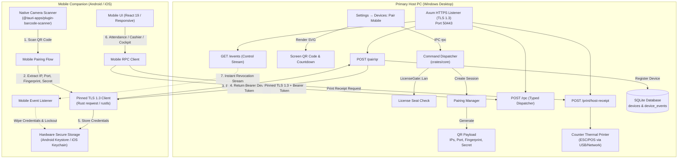
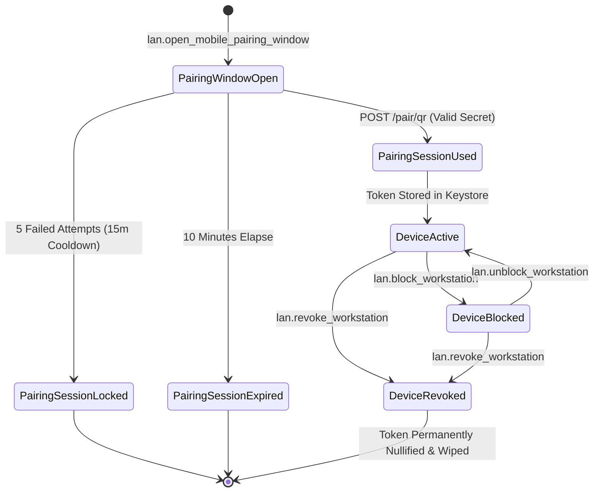

# 0046. Mobile App and LAN QR Pairing

**Date**: 2026-09-26
**Status**: Proposed
**Scope**: Feature 70b · Slice 13 (LAN Multi PC)

## Summary

Coachify introduces an official mobile companion application for Android and iOS that turns staff smartphones and tablets into high speed workstations on the coaching center local network. The mobile client pairs with the primary desktop PC in seconds using optical QR code scanning. The host displays a dynamic QR code encoding its local network addresses, port, and pinned TLS certificate fingerprint alongside an ephemeral pairing secret. Scanning the QR code with the mobile camera completes a mutual TLS 1.3 handshake, bypasses mobile operating system trust barriers against self signed certificates without compromising security, and provisions a persistent hardware secured device token. Running on Tauri 2 Mobile with React 19, the mobile application delivers full operational parity with desktop workstations (including rapid student attendance scanning with native camera acceleration, counter cashier payments, admissions, exams, and live owner intelligence) while routing print jobs to the host thermal receipt printer.

## Structure

This specification covers the mobile application architecture and optical QR pairing subsystem:

- [index.md](index.md): Full architectural specification, acceptance criteria, data models, network protocol, state transitions, mobile API surface, security model, and build plan.
- [rationale.md](rationale.md): Architectural context, options considered (Tauri 2 Mobile versus React Native versus Flutter, optical QR TLS pinning versus cloud relay, live mode versus offline queueing), and design decisions.
- [verify.md](verify.md): Automated integration test suites, manual verification matrix, security drills (man in the middle tests, certificate spoofing, brute force lockouts), and mobile operating system compatibility.

## Requirements

**User stories**:

- As a coaching center teacher or floor supervisor, I want to scan student card barcodes or QR codes continuously using my phone camera with instant audio feedback, so that I can take attendance for seventy students in two minutes right inside the classroom without carrying a laptop.
- As a front desk counter cashier, I want to process student admissions, collect monthly tuition fees, and trigger a printed thermal receipt on the host counter printer from my mobile phone, so that peak morning student rushes are cleared quickly.
- As an administrator setting up a staff phone, I want to open Settings on the host PC, tap "Pair Mobile Device", and scan the displayed QR code with the mobile app camera, so that pairing takes under five seconds with zero manual IP address entry or certificate warnings.
- As an institution owner walking through campus, I want to view the live Today Cockpit, batch health, and real time fee collections on my phone over office Wi-Fi, so that I always know our operational pulse.
- As an institution owner whose staff member leaves or loses their phone, I want to revoke the mobile device immediately with one click on the host PC, so that the phone is severed in under 500 milliseconds and its local hardware credentials are permanently wiped.

**Acceptance criteria**:

- **AC-1: High Entropy Ephemeral QR Code Generation on Host**:
  - The host operator triggers mobile pairing via `lan.open_mobile_pairing_window`, generating an ephemeral 256 bit cryptographically random secret (`qr_secret`) and a corresponding fallback 6 digit numeric code.
  - The QR code encodes a uniform URI: `coachify://pair?host=<ips>&port=<port>&fingerprint=<sha256>&secret=<qr_secret>&inst=<institution_name>&exp=<unix_timestamp>`.
  - The QR payload includes all active IPv4 local network interface addresses of the host machine to support multi homed routers and Wi-Fi access points.
  - The pairing window is valid for exactly 10 minutes (600 seconds), displaying a live countdown timer and regenerating automatically upon expiration.
  - While active, the host advertises `pairing_open: true` on `GET /hello` and sets mDNS TXT `pairing=1`.

- **AC-2: Anti Brute Force Protection and Cooldown Lockout**:
  - The host tracks all failed pairing submissions across both QR secret and 6 digit code paths.
  - Upon 5 consecutive failed attempts from any source within an active window, the host immediately aborts the session, enters a 15 minute security cooldown, resets mDNS `pairing=0`, and logs a security audit event (`security.pairing_brute_force_locked`).
  - During the cooldown, all subsequent pairing requests are rejected with HTTP 403 (`PAIRING_COOLDOWN_ACTIVE`).

- **AC-3: Optical Zero Configuration TLS 1.3 Certificate Pinning & Candidate Racing**:
  - Android and iOS default network stacks strictly reject self signed certificates from local IP addresses. The mobile application bypasses this barrier securely by extracting the host X.509 SHA-256 certificate fingerprint directly from the scanned QR code.
  - The mobile client configures a custom TLS certificate verifier (using rustls danger verifier or native platform trust manager) that validates the server certificate against the exact pinned SHA-256 hash.
  - Candidate IP racing strategy: when the QR code contains multiple IPv4 addresses (for example when the host machine has physical Ethernet, Wi-Fi, and virtual adapters like WSL or Hyper-V), the mobile client connects using parallel candidate racing. The client dispatches concurrent TLS 1.3 handshakes to all candidate addresses with a 2.5 second timeout. The first connection to complete the handshake and match the pinned certificate fingerprint is retained as the active transport; all slower or stalled connections are cancelled immediately.
  - Plain unencrypted HTTP connections are rejected at the mobile transport layer.
  - If a proxy or network attacker alters the host certificate during the handshake, the mobile client terminates the connection immediately with `FINGERPRINT_MISMATCH`.

- **AC-4: Instant Mutual Handshake and Persistent Hardware Credential Custody**:
  - The mobile app submits `POST /pair/qr` over the pinned TLS 1.3 connection immediately upon scanning, transmitting `qr_secret`, `device_name`, `platform` (`android` or `ios`), `device_type` (`mobile_phone` or `tablet`), `os_version`, `app_version`, and a client generated nonce.
  - The host verifies the QR secret using constant time comparison (`subtle::ConstantTimeEq`), marks the pairing session `used`, and generates a 256 bit persistent device token (`dt_...`).
  - The host records `SHA256(device_token)` in the SQLite `devices` table with `paired_via = 'qr'`.
  - The mobile application securely persists the device token, host certificate fingerprint, and host UUID using platform hardware keystores (Android Keystore via EncryptedSharedPreferences, and iOS Keychain Services via the Tauri secure storage plugin).
  - Staff authentication lifecycle: mobile staff authenticate atop the device token by submitting their numeric Staff PIN to `POST /auth/staff-login`. The host verifies the PIN using Argon2id, verifies the staff member active status, and returns a short lived `Staff Session Token` (`st_...`). The mobile app enforces an automatic session lock: when the application is placed in the background for more than 15 minutes, or after 4 hours of inactivity, the session token is evicted from memory and the staff member must re-enter their PIN or use device biometrics to unlock.
  - Plaintext device tokens are never stored in unencrypted mobile files, user defaults, or local web storage.

- **AC-5: License Workstation Quota Enforcement**:
  - Pairing a mobile device requires an active license with the `lan_multi_device` entitlement (tier `local_pro` or active `trial`).
  - Mobile devices count toward the license `workstation_limit`.
  - If `active_workstations >= workstation_limit`, the host rejects `POST /pair/qr` with error code `LAN_WORKSTATION_LIMIT_REACHED` and provides clear upgrade instructions in the response.

- **AC-6: High Speed Native Camera Barcode and QR Viewfinder**:
  - The mobile application integrates native camera scanning via the Tauri barcode scanner plugin, backed by Google ML Kit on Android and Apple Vision framework on iOS.
  - In attendance mode, the viewfinder scans student ID cards and QR badges continuously without manual shutter taps, achieving scan to feedback latency under 150 milliseconds.
  - Successful scans trigger immediate audible audio confirmation and haptic vibration feedback.
  - Duplicate scan guard: scanning the same student badge within 5 seconds is debounced with a visual "Already Scanned" badge to prevent accidental double submissions.

- **AC-7: Host Print Routing and WhatsApp PDF Receipt Sharing**:
  - When a cashier collects a fee or completes an admission on mobile, the client dispatches a print job to the host PC via `POST /print/host-receipt` over LAN RPC.
  - The desktop host reads `receipt_printer_name` from `lan_host_config` (configured in Settings → Printing, falling back to the Windows default printer only if unconfigured). `POST /print/host-receipt` routes the ESC/POS receipt payload explicitly to this designated hardware thermal printer without requiring cashier intervention on the desktop.
  - The mobile interface provides an immediate "Share via WhatsApp" action that generates a receipt PDF locally and opens the native mobile share sheet populated with the guardian mobile phone number.

- **AC-8: Strict Live RPC Architecture, Resilient Reconnection & Quick IP Update**:
  - All financial transactions, student admissions, attendance marks, and exam records execute directly against the host SQLite database via typed LAN RPC calls.
  - When a mobile device moves into a Wi-Fi dead zone, mutating actions are paused with a clear, non blocking status indicator ("Reconnecting to Host...").
  - The mobile network layer performs background reconnection with exponential backoff (1s, 2s, 4s, capped at 10s), resolving host IP changes via mDNS `_coachify._tcp.local` using the pinned host identity.
  - Android mDNS fallback: if local network IP changes occur due to host DHCP renewal and mobile mDNS discovery fails to resolve the host within 10 seconds (for example due to Android battery saver restrictions or Wi-Fi router multicast suppression), the mobile application transitions to a "Host Disconnected" screen. This screen provides an "Update Host IP" camera button. Tapping it allows staff to scan the host screen QR code to immediately update the host IP address and port without revoking the device token or requiring a full re-pairing handshake.
  - When connectivity is restored, the active view refreshes its query cache automatically without losing form input state.

- **AC-9: Real Time SSE Control Stream and Sub 500ms Instant Revocation**:
  - Paired mobile devices maintain an authenticated Server Sent Events stream (`GET /events` with `X-Coachify-Device-Token`).
  - When the host administrator blocks or revokes a mobile device in Settings, the host pushes a targeted `device.revoked` or `device.blocked` event over the SSE connection.
  - Upon receiving the event, the mobile app immediately severs the network session, purges the stored device token from hardware keystore, clears in memory staff credentials, and transitions the screen to "Device Access Revoked" in under 500 milliseconds.
  - Any subsequent API request carrying a revoked token is rejected at the host transport layer with HTTP 403 (`DEVICE_REVOKED`).

- **AC-10: Immutable Audit Logging and Device Event History**:
  - All mobile device lifecycle events (`paired`, `renamed`, `blocked`, `unblocked`, `revoked`, `scanned_attendance`, `collected_payment`) are written to `device_events` and central `audit_log` with remote IP, device model, and staff user ID.
  - Cashier payment records and attendance entries capture the `device_id` of the mobile device to maintain complete audit visibility between desktop counters and mobile staff.

## Decision

**Chosen option**: Option 1: Tauri 2 Mobile Companion Application (React 19, TypeScript, Rust) with Optical QR TLS 1.3 Certificate Pinning, Hardware Keystore Token Storage, Native Camera Scanner Plugin, Host Print Routing, and Strict Live RPC.

We build the Coachify mobile companion using Tauri 2 Mobile. This maximizes code reuse across desktop and mobile, sharing identical React 19 UI components, Tailwind CSS v4 design tokens, and typed Specta RPC contracts. Optical QR scanning transmits the host IP candidates and self signed TLS certificate fingerprint out of band, eliminating mobile operating system certificate warnings. The mobile client stores credentials in Android Keystore and iOS Keychain, marks attendance with native ML Kit and Vision barcode scanning, routes thermal receipts to the desktop host printer, and executes authoritative transactions live against the host SQLite database.

**Implementation skills**: `rust-best-practices` (`apollographql/skills`, `.claude/skills/rust-best-practices/`) · `tauri-v2` (`nodnarbnitram/claude-code-extensions`, `.claude/skills/tauri-v2/`) · `shadcn` (`shadcn/ui`, `.claude/skills/shadcn/`) · `tailwind-4-docs` (`lombiq/tailwind-agent-skills`, `.claude/skills/tailwind-4-docs/`) · `tanstack-query` (`tanstack-skills/tanstack-skills`, `.claude/skills/tanstack-query/`) · `vitest` (`antfu/skills`, `.claude/skills/vitest/`)

## Rationale

Reasoning, architectural options considered, and tradeoffs: see [rationale.md](rationale.md).

## Proposed stack

| Layer | Choice | Reason |
|---|---|---|
| Mobile Runtime | Tauri 2 Mobile (iOS & Android) | Direct reuse of desktop React 19 UI, design tokens, and typed Specta RPC bindings without maintaining two separate codebases. |
| Mobile Language | TypeScript 5.7+ & Rust 1.85+ | Strict type safety across UI and native shell with zero runtime overhead on budget mobile devices. |
| Optical QR Parser & Barcode Scanner | `@tauri-apps/plugin-barcode-scanner` (ML Kit & Vision) | Native hardware accelerated camera processing delivering sub 150ms scan latency and zero JavaScript canvas lag. |
| Network Transport | `reqwest` & `rustls` with custom fingerprint verifier | Enforces TLS 1.3 with pinned SHA-256 certificate validation, bypassing mobile CA stores safely. |
| Credential Custody | `@tauri-apps/plugin-secure-storage` | Delegates device token encryption to Android Keystore (AES-256-GCM) and iOS Keychain Services. |
| Real Time Control | Server Sent Events (`GET /events`) | Lightweight unidirectional event stream enabling sub 500ms remote device revocation and live state sync. |
| UI Framework | React 19, Vite, Tailwind CSS v4, Lucide Icons | Identical component primitives and fluid responsive design standardized under Spec 0034 and design.md. |
| Receipt Printing | Host Printer RPC (`POST /print/host-receipt`) + PDF share | Leverages existing front desk thermal receipt printer over LAN without purchasing separate mobile Bluetooth printers. |

## Feature design

### System Architecture & Pairing Topology



### Optical QR Payload Specification

The host desktop generates an ephemeral URI encoded into a standard QR code (Version 5 to 7, Error Correction Level M). The QR URI schema is structured as follows:

```
coachify://pair?v=1&host=192.168.1.50,10.0.0.12&port=50443&fp=3b8a1f6492d2b56e890c2a71f84501de1247b9983412a0134bc5792d426189ef&sec=qs_0192e4ab8c237894bcde1029384756af&inst=Daffodil+Academy&exp=1790432400
```

| Parameter | Type | Required | Description |
|---|---|---|---|
| `v` | integer | Yes | Pairing protocol version (currently `1`). |
| `host` | string | Yes | Comma separated list of active local IPv4 interface addresses discovered on the host PC. |
| `port` | integer | Yes | Active port bound by the host HTTPS listener (default `50443`). |
| `fp` | hex string | Yes | SHA-256 fingerprint (64 lowercase hex characters) of the host X.509 certificate for TLS pinning. |
| `sec` | string | Yes | Ephemeral 256 bit pairing secret prefixed with `qs_` (valid for 10 minutes, single use). |
| `inst` | string | Yes | URL encoded institution name for user confirmation on the mobile display. |
| `exp` | integer | Yes | Unix epoch expiration timestamp of the pairing session. |

### Data Model (SQLite Schema Enhancements)

This feature builds directly upon SQLite Migration `0025_workstation_pairing.sql`, ensuring full support for mobile devices and optical QR pairing sessions:

```sql
-- Track paired devices with mobile platform and pairing origin
ALTER TABLE devices ADD COLUMN paired_via TEXT NOT NULL DEFAULT 'code' 
    CHECK (paired_via IN ('code', 'qr', 'manual'));

-- Ensure pairing sessions track QR secret hashes
ALTER TABLE lan_pairing_sessions ADD COLUMN qr_secret_hash TEXT NULL UNIQUE;

-- Create index for instant QR secret lookup
CREATE INDEX IF NOT EXISTS idx_lan_pairing_sessions_qr_hash 
    ON lan_pairing_sessions(qr_secret_hash);
```

### State Transitions



### API Surface

| Endpoint | Method | Key Inputs | Key Outputs | Auth | Key Errors |
|---|---|---|---|---|---|
| `/pair/qr` | POST | `qr_secret:string`, `device_name:string`, `platform:string`, `device_type:string`, `os_version:string`, `app_version:string`, `client_nonce:string` | `device_id:string`, `device_token:string`, `institution_name:string`, `host_id:string`, `host_name:string`, `active_features:string[]` | Ephemeral `qr_secret` | 400 Bad Request, 403 Forbidden (`PAIRING_SECRET_INVALID`, `PAIRING_EXPIRED`, `PAIRING_LOCKED`, `WORKSTATION_LIMIT_REACHED`), 409 Conflict |
| `/pair` | POST | `pairing_code:string`, `device_name:string`, `platform:string`, `client_nonce:string` | Same as `/pair/qr` | Ephemeral 6 digit code | 400 Bad Request, 403 Forbidden |
| `/auth/staff-login` | POST | `staff_pin:string` (4 to 6 digits) | `session_token:string`, `staff_id:string`, `role:string`, `full_name:string`, `permissions:string[]`, `expires_at:string` | Bearer Device Token (`X-Coachify-Device-Token`) | 400 Bad Request, 401 Unauthorized (`INVALID_STAFF_PIN`), 403 Forbidden (`DEVICE_REVOKED`) |
| `/events` | GET | None (Client initiates SSE connection) | SSE Stream (`device.revoked`, `device.blocked`, `device.ping`, `data.refresh`) | Bearer Device Token (`X-Coachify-Device-Token`) | 401 Unauthorized, 403 Forbidden (`DEVICE_REVOKED`, `DEVICE_BLOCKED`) |
| `/rpc` | POST | `method:string`, `params:object` | Typed RPC Result object | Bearer Device Token + Staff Session Token | 401 Unauthorized, 403 Forbidden, 422 Unprocessable |
| `/print/host-receipt` | POST | `payment_id:string`, `receipt_template:string`, `copies:number` | `print_job_id:string`, `status:string`, `printer_name:string` | Bearer Device Token | 400 Bad Request, 403 Forbidden, 503 Printer Unavailable |

### Value Sourcing

| Action | Value Produced / Displayed | Source |
|---|---|---|
| Display Pairing QR Code | QR Matrix (SVG / PNG) | Encoded from `lan_pairing_sessions.qr_secret`, host IP addresses from network interfaces, and host certificate fingerprint from `lan_host_config`. |
| Scan QR Code on Mobile | Host IP address candidates | Decoded from URI parameter `host` in QR payload. |
| Parallel IP Candidate Racing | Active Transport IP | First IP candidate to finish TLS 1.3 handshake and match certificate fingerprint within 2.5s timeout. |
| Configure Pinned TLS Client | SHA-256 certificate fingerprint | Decoded from URI parameter `fp` in QR payload. |
| Submit Pairing Request | `qr_secret` | Decoded from URI parameter `sec` in QR payload. |
| Verify Pairing Request | Match against active session | Constant time SHA-256 hash comparison against `lan_pairing_sessions.qr_secret_hash`. |
| Issue Device Token | Persistent Bearer Token (`dt_...`) | CSPRNG 256 bit random string generated on host, hashed into `devices.token_hash`. |
| Authenticate Mobile Staff | Staff Session Token (`st_...`) | Argon2id verification of staff PIN against `staff.pin_hash` in SQLite, returning token with 4 hour sliding expiry. |
| Store Credentials on Mobile | Encrypted token storage | Stored via native `@tauri-apps/plugin-secure-storage` in Android Keystore / iOS Keychain. |
| Print Counter Receipt | Printed thermal slip | Host PC prints to designated hardware printer read from `lan_host_config.receipt_printer_name` (falling back to Windows default). |
| Share Receipt on WhatsApp | PDF receipt file | Rendered locally in mobile app from receipt data and passed to mobile native share sheet. |
| Recover Host IP on Android | Updated Host IP and Port | Decoded from URI parameter `host` and `port` upon scanning new QR code without re-pairing. |

### Key Invariants

1. **Self Signed Certificate Pinning Guarantee**: Mobile clients never trust system certificate authority stores for LAN connections. The mobile client connects exclusively if the server TLS certificate SHA-256 fingerprint matches the pinned hash delivered through the optical QR code.
2. **Single Use Ephemeral QR Secret**: The `qr_secret` is single use. Upon the first successful pairing handshake, the session status immediately transitions to `used` and all subsequent requests with that secret are rejected.
3. **Anti Brute Force Window**: 5 consecutive failed code or secret submissions lock all pairing windows for 15 minutes across all interfaces.
4. **Hardware Key Isolation**: Device tokens on mobile devices are never stored in plaintext SQLite databases, web localStorage, or unencrypted filesystem files. They reside strictly in the operating system hardware keystore.
5. **Authoritative Host Execution**: All mutating business operations (marking attendance, taking payments, admitting students, entering marks) execute directly on the host PC database via LAN RPC. Mobile clients do not maintain a divergent local database replica.
6. **Sub 500ms Revocation Severance**: Revoking a mobile device from the host settings pushes an SSE event that purges mobile credentials and transitions the client to a lockout screen in under 500 milliseconds.

### Security Model

- **Transport Security**: TLS 1.3 encryption across all communication. Eavesdropping on local Wi-Fi captures only encrypted ciphertext.
- **Mutual Authentication**:
  - Host identity is verified by the mobile app using the out of band pinned SHA-256 certificate fingerprint scanned from the host screen.
  - Mobile device identity is authenticated by the host via persistent 256 bit bearer tokens (`dt_...`).
  - Staff user permissions are enforced via staff login sessions atop the device token. A valid device token alone does not permit transactions without an authenticated staff session.
- **RBAC Enforcement**: The central command dispatcher checks user permissions on the host for every mobile RPC call. A mobile phone assigned to a teacher role cannot access owner intelligence dashboards or delete student records.
- **Physical Proximity Barrier**: Generating a pairing QR code requires physical presence in front of the host PC screen. A malicious actor on the local Wi-Fi cannot pair a device without optical access to the host monitor.

### Configuration Required

Zero new external cloud API keys or environment variables required. All configuration is local:

- Mobile application package identifier: `com.coachify.mobile`
- Native camera permission strings:
  - iOS (`Info.plist`): `NSCameraUsageDescription` ("Coachify needs camera access to scan student ID cards and pair with your desktop host.")
  - Android (`AndroidManifest.xml`): `<uses-permission android:name="android.permission.CAMERA" />`

### Critical Test Scenarios

- **Happy Path (QR Pairing & Attendance)**: Operator opens pairing modal on host PC, mobile app scans QR code, establishes pinned TLS 1.3 connection, stores device token in keystore, logs in as teacher, and scans 10 student cards with sub 150ms audio feedback, verifies **AC-1**, **AC-3**, **AC-4**, **AC-6**.
- **Security Barrier (Certificate Spoofing / MITM)**: Attacker on local Wi-Fi proxies connection with a different TLS certificate; mobile client detects fingerprint mismatch and terminates handshake immediately with error, verifies **AC-3**.
- **Anti Brute Force Drill**: Attacker submits 5 invalid pairing secrets within 60 seconds; host enters 15 minute security lockout and rejects all attempts, verifies **AC-2**.
- **License Limit Enforcement**: Host on a 2 device license attempts to pair a 3rd device; host rejects request with `LAN_WORKSTATION_LIMIT_REACHED`, verifies **AC-5**.
- **Remote Revocation SLA**: Host operator revokes active phone from Settings; mobile app receives SSE event, wipes keystore, and transitions to lockout screen in under 420 milliseconds, verifies **AC-9**.
- **Host Receipt Print Routing**: Cashier records fee payment on mobile; host PC prints thermal receipt on its USB printer and mobile displays WhatsApp share sheet, verifies **AC-7**.
- **Local Network Recovery**: Mobile device drops Wi-Fi connection, shows non blocking reconnect indicator, reconnects automatically when re entering range, and resumes query state cleanly, verifies **AC-8**.

## Build plan

The build plan follows the Tracer Bullet approach, standing up a thin end to end thread through every layer first (QR generation, optical scanning, TLS pinning, and instant pairing), then thickening the slice with camera attendance scanning, cashier workflows, and remote management.

### Milestone 1: Ephemeral QR Generation & Host Pairing Endpoint (Tracer Bullet Core)
- [ ] Implement `lan.open_mobile_pairing_window` in `crates/core/src/lan.rs`, generating 256 bit `qr_secret`, SHA-256 hash persistence, and QR URI formatting, satisfies **AC-1**.
- [ ] Add brute force counter and 15 minute cooldown lockout logic in `crates/core/src/lan.rs`, satisfies **AC-2**.
- [ ] Implement `POST /pair/qr` endpoint in host Axum listener with constant time comparison, device token generation, and license seat checks, satisfies **AC-4**, **AC-5**.
- [ ] Add pairing modal with SVG QR code renderer and live 10 minute countdown timer in `ui/src/components/settings/lan-host-settings-card.tsx`, satisfies **AC-1**.

### Milestone 2: Mobile Client Runtime & Pinned TLS Handshake (Tracer Bullet Mobile)
- [ ] Scaffold Tauri 2 Mobile project configuration for Android and iOS in `src-tauri` with camera and secure storage plugins, satisfies **AC-3**, **AC-4**.
- [ ] Implement custom TLS certificate verifier in Rust client network transport using pinned SHA-256 fingerprint, satisfies **AC-3**.
- [ ] Build mobile pairing screen with optical QR scanner viewfinder, URI parser, and automated `POST /pair/qr` handshake, satisfies **AC-1**, **AC-4**.
- [ ] Implement hardware keystore token persistence using `@tauri-apps/plugin-secure-storage`, satisfies **AC-4**.

### Milestone 3: High Speed Native Camera Attendance Scanner
- [ ] Integrate `@tauri-apps/plugin-barcode-scanner` with Google ML Kit (Android) and Apple Vision (iOS) for continuous card scanning, satisfies **AC-6**.
- [ ] Implement audio beep confirmation and haptic feedback on successful scan with 5 second duplicate debounce guard, satisfies **AC-6**.
- [ ] Connect attendance scanner directly to `attendance.mark` RPC on host with instant optimistic visual feedback, satisfies **AC-6**, **AC-8**.

### Milestone 4: Mobile Cashier, Admissions & Host Print Routing
- [ ] Build responsive mobile cashier collection view and quick admission flow optimized for touch ergonomics, satisfies **AC-7**, **AC-8**.
- [ ] Implement `POST /print/host-receipt` RPC on host to trigger counter thermal receipt printing from mobile actions, satisfies **AC-7**.
- [ ] Implement client side PDF receipt generator with native mobile WhatsApp share sheet integration, satisfies **AC-7**.

### Milestone 5: Real Time SSE Control Stream, Disconnect SLA & Audit Trails
- [ ] Connect mobile client to persistent `GET /events` SSE control channel with automatic reconnection and heartbeat monitoring, satisfies **AC-8**, **AC-9**.
- [ ] Implement sub 500ms instant remote severance on `device.revoked` or `device.blocked` events with hardware keystore purge, satisfies **AC-9**.
- [ ] Log all mobile lifecycle and transaction events to `device_events` and central `audit_log`, satisfies **AC-10**.

## Consequences

**Positive**:
- Eliminates counter bottleneck: staff can move freely around the coaching center to take attendance, enroll walk in students, and collect fees during rush hours.
- Zero configuration pairing: staff do not need to look up IP addresses, configure router ports, or bypass browser certificate security warnings.
- Uncompromised local security: optical QR transmission provides authentic out of band certificate verification, protecting sensitive student data across local Wi-Fi without internet connectivity.
- Massive code reuse: Tauri 2 Mobile shares the existing React 19 UI codebase, Tailwind CSS v4 design system, and typed Specta RPC contracts.

**Negative**:
- Building and packaging mobile applications requires Android Studio (Android SDK / NDK) and Xcode (macOS machine required for iOS builds).
- Wi-Fi quality in older coaching centers with thick concrete walls may produce dead zones in back classrooms.

**Neutral**:
- Mobile devices consume workstation license seats under the `workstation_limit` quota.

## Follow-up

1. Configure GitHub Actions CI workflow to build Android APK and iOS IPA release artifacts using Tauri 2 CLI.
2. Enroll mobile barcode scanner plugin in `AGENTS.md` dependencies list.
3. Validate optical QR scanning performance across budget Android devices (such as 3GB RAM devices common among coaching center staff).

## References

### Project sources
- `AGENTS.md`: Stack conventions, build approach (Tracer Bullet), and architecture rules.
- Spec 0044 (`docs/specs/0044-lan-host-service-and-discovery/index.md`): LAN host service, TLS 1.3 listener on port 50443, self signed certificates, and mDNS discovery.
- Spec 0045 (`docs/specs/0045-workstation-pairing-and-device-management/index.md`): Workstation pairing, 6 digit code handshake, persistent device tokens, and SSE control streams.
- Spec 0034 (`docs/specs/0034-ui-ux-design-sizing-typography-responsiveness/index.md`): Responsive design system, mobile typography, and fluid touch ergonomics.
- Spec 0023 (`docs/specs/0023-attendance/index.md`): Attendance domain models and rapid marking workflows.
- Spec 0013 & Spec 0035: Thermal receipt printing engine and professional layout system.

### Practices & standards
- **Optical Out of Band Key Exchange**: Exchanging TLS certificate fingerprints via visual QR codes prevents active man in the middle attacks on unauthenticated local networks.
- **TLS 1.3 Certificate Pinning**: Custom cryptographic verification against known SHA-256 certificate fingerprints without relying on external commercial Certificate Authorities.
- **Hardware Keystore Custody**: Storing cryptographic bearer tokens in tamper resistant hardware (Android Keystore / iOS Keychain Services).
- **Tracer Bullet Delivery**: Standing up a thin thread from QR code scan to pinned TLS handshake before thickening user interfaces.
