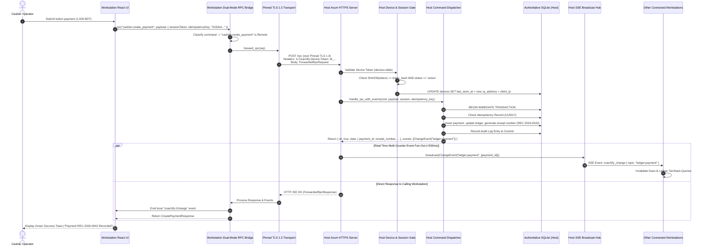
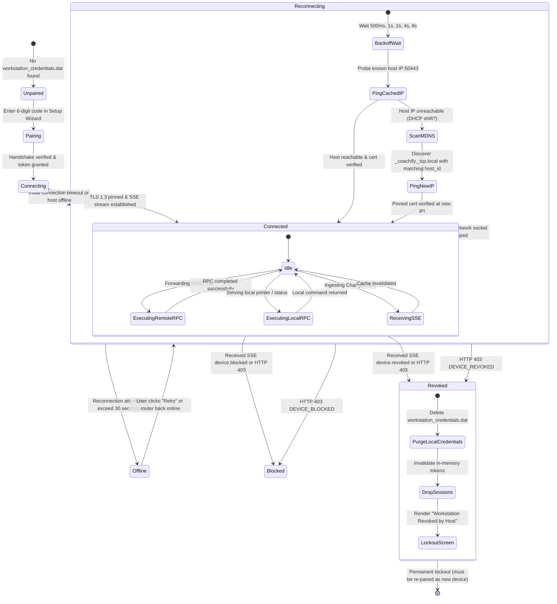

# 0047. LAN Workstation Client Mode and RPC Transport

**Date**: 2026-09-26
**Status**: Specified / Ready for Development
**Scope**: Feature 71 · Slice 13 (LAN Multi PC)

## Summary

Coachify enables multi-counter coaching center operations across an offline local network without internet connectivity. Building directly upon the secure network runtime in Spec 0044 (LAN Host Service & Discovery, Feature 69) and the cryptographic pairing handshake in Spec 0045 (Workstation Pairing and Device Management, Feature 70), **Feature 71** delivers the operational runtime for secondary workstations: **LAN Workstation Client Mode and RPC Transport**.

In Workstation Client Mode, a secondary desktop PC (e.g. front desk reception, cashier counter 1 & 2, accountant desk) operates without a local business database. Instead, the application shell's single typed RPC entrypoint transparently forwards domain queries and mutations over pinned TLS 1.3 to the primary host PC's authoritative SQLite engine (`POST /rpc`). Crucially, hardware peripherals and physical document printing remain **strictly local to the workstation**: when a cashier collects a fee on Counter 2, the receipt data is fetched from the host database, but the physical thermal receipt rasterizes and prints locally on Counter 2's attached USB printer. 

Workstations maintain an active Server-Sent Events (SSE `GET /events`) control channel with the host, ensuring that database change events (`ChangeEvent`) broadcast across all counters in under 500 milliseconds for seamless TanStack Query cache synchronization. The transport layer implements resilient automatic reconnection with exponential backoff and dynamic mDNS host re-discovery if the host PC's DHCP IP address shifts. In-flight mutation safety is guaranteed through client-generated UUIDv7 idempotency keys, eliminating duplicate financial entries during Wi-Fi drops.

## Structure

This specification covers Feature 71 of Slice 13 (LAN Multi PC):

- [index.md](index.md): Full architectural specification, acceptance criteria, communication topology, data models, network protocol, state transitions, API surface, security model, and build plan for LAN Workstation Client Mode & RPC Transport.
- [rationale.md](rationale.md): Architectural context, options considered (thin TLS RPC vs thick SQLite replication; HTTP/1.1 vs WebSockets; local vs remote printer rasterization; static IP vs dynamic mDNS re-discovery), and design decisions.
- [verify.md](verify.md): Automated integration test suites, network partition drills, multi-counter concurrency benchmarks, local printing verification, and manual two-PC QA matrix.

## Requirements

**User stories**:

- As a counter cashier on a secondary workstation, I want Coachify to open directly into my cashier desk and allow me to look up students, take tuition payments, and admit students, so that I can serve students just as quickly as on the main computer.
- As a cashier collecting fees on Counter 2, I want thermal receipts to print immediately on my own desk's receipt printer, so that I do not have to walk over to the owner's office to collect printed receipts.
- As a front-desk receptionist on Counter 1, I want student dues and payment histories to update in real time when Counter 2 collects a payment, so that we never accidentally collect fees twice for the same student.
- As a coaching center owner, I want all financial numbers, audit records, and student profiles to reside authoritatively on my primary host PC, so that secondary laptops never have independent, conflicting copies of our institution's data.
- As a cashier experiencing occasional office Wi-Fi dropouts, I want the application to automatically reconnect when the signal returns without losing my typed form data or creating duplicate transactions, so that temporary router blips don't halt our morning rush.
- As an administrator, I want to clearly see our workstation connection status, server latency (RTT), and host computer identity in the top header, so that I immediately know if our network connection is healthy.

**Acceptance criteria**:

- **AC-1: Transparent Dual-Mode RPC Dispatcher**:
  - The client application maintains a unified typed RPC bridge (`rpc(command, payload, options)`) identical to Standalone and Host modes.
  - Commands are classified into two distinct execution pathways:
    - **Local Commands**: executed directly on the workstation without network transit (e.g. `printers.list`, `printers.get_settings`, `printers.save_settings`, `lan.get_client_status`, `lan.reconnect`, `lan.disconnect_workstation`, `system.get_client_info`).
    - **Remote Domain Commands**: forwarded over pinned TLS 1.3 to the primary host PC's `POST /rpc` endpoint (e.g. `auth.*`, `students.*`, `fees.*`, `ledger.*`, `cashier.*`, `attendance.*`, `exams.*`, `reports.*`, `comms.*`, `audit.*`, `receipts.get_printable`).
  - The React UI requires zero code branching or knowledge of the underlying execution location.
- **AC-2: Pinned TLS 1.3 Forwarding Transport (`POST /rpc`)**:
  - The host HTTPS listener exposes `POST /rpc` on port 50443.
  - Workstations forward commands exclusively over TLS 1.3 with X.509 certificate SHA-256 fingerprint verification matching the host fingerprint stored in `%LocalAppData%\Coachify\workstation_credentials.dat`.
  - Plaintext unencrypted HTTP connections and connections with mismatched fingerprints are rejected at the transport layer before request parsing.
  - The host parses the incoming payload, updates device metrics (`last_seen_at`, `ip_address`), executes `coachify_core::handle_rpc_with_events`, and returns the typed JSON response alongside any generated `ChangeEvent` records.
- **AC-3: Hardware-Bound Bearer Device Token Authentication**:
  - Every forwarded RPC request transmits the workstation's 256-bit device token in the `X-Coachify-Device-Token` header.
  - The host computes `SHA256(device_token)` and validates that `devices.status == 'active'`.
  - If the device is blocked or revoked, the host terminates the request immediately with HTTP 403 Forbidden (`DEVICE_BLOCKED` or `DEVICE_REVOKED`).
  - Staff user authentication (`Authorization: Bearer <session_token>`) sits atop the device token. A valid device token permits workstation network access, while a valid staff session token authorizes specific domain operations based on RBAC permissions.
- **AC-4: Complete Domain Module Feature Parity**:
  - Secondary workstations support 100% of desktop domain capabilities permitted by the logged-in staff role:
    - Cashier fee collection, receipt generation, invoice reprints, and daily cash closes.
    - Student admissions, directory searches, profile editing, and guardian links.
    - Batch enrollments, subject rosters, and academic sessions.
    - Daily class attendance marking and monthly attendance registers.
    - Exam management, spreadsheet-style mark entry grids, GPA calculations, and report card previews.
    - Financial reports, audit log inspection, and SMS/WhatsApp broadcast queues.
- **AC-5: Strictly Local Document & Receipt Printing**:
  - Receipt and document printing actions executed on a workstation print exclusively to that workstation's attached printers.
  - When a payment is processed:
    1. The workstation calls `receipts.get_printable` (remotely over TLS) to fetch payment itemization and English/Bengali amount in words.
    2. The workstation's local React engine renders the HTML receipt template (`generateThermalReceiptHtml` or `generateA4DualReceiptHtml`).
    3. The workstation invokes `executeHtmlPrint` locally against its own selected Windows printer spooler (`printers.get_settings` read from local machine storage).
  - The host PC printer is never triggered for workstation transactions unless explicitly requested via host print routing.
- **AC-6: Real-Time Multi-Counter SSE Event Synchronization**:
  - Connecting workstations maintain an active Server-Sent Events stream (`GET /events` with `X-Coachify-Device-Token`).
  - When any workstation or the host commits a mutation producing `ChangeEvent`s (e.g. `ledger:payment`, `student:updated`, `attendance:marked`), the host broadcasts the event to all connected workstations via Tokio broadcast channels.
  - The workstation client receives the SSE packet and emits `coachify://change` to the local Tauri window.
  - TanStack Query automatically invalidates affected cache keys, updating UI tables and dues indicators across all desks in under **500 milliseconds**.
- **AC-7: Resilient Disconnect Handling & Dynamic Host Re-Discovery**:
  - If an office Wi-Fi blip or network disconnect occurs:
    - The client transitions its visual status to `Reconnecting` without crashing or clearing active form inputs.
    - Reconnection retries execute with exponential backoff (500ms, 1s, 2s, 4s, capped at 8s).
    - If the host PC's IP address shifted due to router DHCP renewal, the workstation automatically triggers a background mDNS query (`_coachify._tcp.local`) to discover the host's new IP matching the pinned `host_id` and fingerprint.
    - Once re-established, the client resumes the SSE stream and refreshes active query caches automatically.
- **AC-8: In-Flight Mutation Protection via Client Idempotency**:
  - Every mutating command generates an `idempotency_key` (UUIDv7) on the workstation before network transmission.
  - If a network drop occurs after the host commits the transaction but before the workstation receives the response, the workstation re-transmits the command with the identical `idempotency_key`.
  - The host's dispatcher recognizes the existing idempotency record and returns the original result without duplicating charges, creating duplicate receipt numbers, or logging double audit entries.
- **AC-9: Sub-500ms Instant Remote Severance Enforcement**:
  - When the host administrator revokes or blocks a workstation in Settings, the host pushes a targeted `device.revoked` or `device.blocked` event down that workstation's SSE pipe.
  - The workstation SSE listener receives the event, wipes local DPAPI credentials (`workstation_credentials.dat`), terminates in-memory user sessions, and transitions the UI to the "Access Revoked" screen in under **500 milliseconds**.
  - Any subsequent or in-flight HTTP RPC request carrying the revoked token is rejected at the host transport layer with HTTP 403 (`DEVICE_REVOKED`).
- **AC-10: Workstation Health Monitoring & Latency Diagnostics**:
  - The application header displays a live Workstation Status Indicator showing connection health (`Connected`, `Reconnecting`, `Offline`), paired host name, and real-time round-trip latency (RTT in milliseconds).
  - Background heartbeats ping the host every 15 seconds to detect dead TCP connections and check clock synchronization.
  - Workstation Settings provides connection diagnostics, a manual "Reconnect" button, and an "Unpair Workstation" action with a safety confirmation dialog.

## Decision

**Chosen option**: Option 1: Asynchronous Forwarding RPC Transport over Pinned TLS 1.3 (`POST /rpc`), Local Peripheral & Print Engine Isolation, Persistent SSE Event Fan-Out Hub, Dynamic mDNS IP Re-Discovery, Client-Side UUIDv7 Idempotency Protection, and Windows DPAPI Credential Custody.

We implement Workstation Client Mode as a specialized thin-client runtime within the Coachify desktop shell. Rather than maintaining complex multi-master SQLite replication across offline PCs, the workstation forwards all business logic and database commands over pinned TLS 1.3 to the host's central dispatcher (`POST /rpc`). Crucially, the workstation retains complete local custody over its own Windows print spooler and hardware peripherals: receipts and reports fetch data remotely, but layout rendering, thermal rasterization, paper cutting, and cash drawer triggers execute locally on that counter's machine. Dynamic mDNS re-discovery protects against DHCP IP shifts, client idempotency keys guarantee zero duplicate transactions during Wi-Fi drops, and real-time SSE fan-out maintains sub-500ms cache consistency across all coaching center desks.

**Implementation skills**: `rust-best-practices` (`apollographql/skills`, `.claude/skills/rust-best-practices/`) · `tauri-v2` (`nodnarbnitram/claude-code-extensions`, `.claude/skills/tauri-v2/`) · `shadcn` (`shadcn/ui`, `.claude/skills/shadcn/`) · `tailwind-4-docs` (`lombiq/tailwind-agent-skills`, `.claude/skills/tailwind-4-docs/`) · `tanstack-query` (`tanstack-skills/tanstack-skills`, `.claude/skills/tanstack-query/`) · `vitest` (`antfu/skills`, `.claude/skills/vitest/`)

## Rationale

Reasoning, architectural options considered, and trade-off analyses: see [rationale.md](rationale.md).

## Feature Design

### System Architecture & Communication Topology

```mermaid
flowchart TD
    subgraph WorkstationPC["Secondary Workstation PC (Counter 2 Cashier Desk)"]
        WS_UI["React 19 UI (Cashier / Attendance / Exams)"] -->|rpc(cmd, payload)| WS_BRIDGE["Dual-Mode RPC Bridge<br/>(src-tauri / core)"]
        
        WS_BRIDGE -->|Local Commands| WS_LOCAL["Local Machine Handlers"]
        WS_LOCAL --> WS_PRINT["Local Windows Print Spooler<br/>(USB Thermal Printer / POS-80)"]
        WS_LOCAL --> WS_SETTINGS["Local Workstation Storage<br/>(workstation_printer_settings.json)"]
        WS_LOCAL --> WS_DPAPI["Windows DPAPI<br/>(workstation_credentials.dat)"]
        
        WS_BRIDGE -->|Remote Commands| WS_TRANSPORT["Pinned TLS 1.3 Forwarding Client<br/>(reqwest / rustls)"]
        WS_TRANSPORT -->|Inject Headers| WS_REQ["POST /rpc<br/>X-Coachify-Device-Token<br/>Authorization: Bearer session<br/>X-Coachify-Idempotency-Key"]
        
        WS_SSE_CLIENT["SSE Background Worker<br/>(GET /events)"] -->|Ingest ChangeEvent| WS_EVT_BUS["Tauri Emitter<br/>coachify://change"]
        WS_EVT_BUS -->|Invalidate Queries| WS_UI
        
        WS_RECON["Reconnection Watchdog &<br/>mDNS Resolver"] -->|Track Network| WS_TRANSPORT
    end

    subgraph HostPC["Primary Host PC (Admin Office / Windows Desktop)"]
        H_HTTPS["Axum HTTPS Server (TLS 1.3)<br/>Port 50443"] --> H_RPC_EP["POST /rpc Endpoint"]
        H_HTTPS --> H_SSE_EP["GET /events Endpoint"]
        
        H_RPC_EP --> H_DEV_AUTH["Device Token Authenticator<br/>(Validate devices.token_hash & status)"]
        H_DEV_AUTH -->|Valid & Active| H_DISP["Central Command Dispatcher<br/>(crates/core/src/dispatcher.rs)"]
        
        H_DISP --> H_DB[(Authoritative SQLite Database<br/>dev.db)]
        H_DISP -->|Emit ChangeEvents| H_BROADCAST["Tokio Broadcast Hub<br/>(tokio::sync::broadcast)"]
        
        H_BROADCAST --> H_SSE_EP
        H_BROADCAST -->|Local UI Sync| H_UI["Host UI: Coachify Local Pro"]
    end

    WS_REQ -->|Pinned TLS 1.3| H_RPC_EP
    H_SSE_EP -.->|Real-Time SSE Stream| WS_SSE_CLIENT
```

### Data Model & Runtime Memory Architecture

#### 1. Workstation Local Credential Schema (Windows DPAPI Custody)

Workstation credentials are encrypted via Windows DPAPI (`CryptProtectData` machine scope) in `%LocalAppData%\Coachify\workstation_credentials.dat`. The decrypted structure matches:

```rust
#[derive(Debug, Clone, Serialize, Deserialize)]
pub struct WorkstationCredentials {
    pub device_id: String,           // UUIDv7 assigned by host
    pub device_token: String,        // 256-bit bearer token prefixed dt_
    pub host_id: String,             // UUIDv7 of primary host PC
    pub host_fingerprint: String,    // SHA-256 uppercase hex fingerprint
    pub host_ip: String,             // Last known host IPv4 address
    pub host_port: u16,              // Host port (default 50443)
    pub host_name: String,           // Host machine NetBIOS or institution name
    pub workstation_name: String,    // Friendly label e.g. "Counter 2 - Cashier"
    pub paired_at: String,           // ISO 8601 UTC timestamp
}
```

#### 2. Workstation Runtime State Machine & Client State

The in-memory client manager tracks connection liveness and coordinates background reconnection:

```rust
#[derive(Debug, Clone, Copy, PartialEq, Eq, Serialize, Deserialize, Type)]
pub enum WorkstationConnectionState {
    Connected,       // Pinned TLS verified, SSE stream active, latency < 100ms
    Connecting,      // Initial TLS handshake or recovery in progress
    Reconnecting,    // Network dropped; retrying with exponential backoff
    Offline,         // Host unreachable for > 30s; manual intervention available
    Blocked,         // Suspended by host administrator
    Revoked,         // Permanently decommissioned by host administrator
}

#[derive(Debug, Clone, Serialize, Deserialize, Type)]
pub struct WorkstationClientStatus {
    pub mode: String,                               // "workstation_client"
    pub connection_state: WorkstationConnectionState,
    pub host_id: Option<String>,
    pub host_ip: Option<String>,
    pub host_port: Option<u16>,
    pub host_name: Option<String>,
    pub device_id: Option<String>,
    pub workstation_name: Option<String>,
    pub latency_ms: Option<u64>,
    pub last_synced_at: Option<String>,
    pub is_reconnecting: bool,
    pub reconnect_attempts: u32,
}
```

#### 3. Host Network RPC Envelope Specification

Forwarded commands to `POST /rpc` encode a standardized request and response envelope:

```rust
#[derive(Debug, Clone, Serialize, Deserialize)]
pub struct ForwardedRpcRequest {
    pub command: String,
    pub payload: serde_json::Value,
    pub session_token: Option<String>,
    pub idempotency_key: Option<String>,
}

#[derive(Debug, Clone, Serialize, Deserialize)]
pub struct ForwardedRpcResponse {
    pub ok: bool,
    pub data: Option<serde_json::Value>,
    pub error: Option<RpcError>,
    pub events: Vec<ChangeEvent>,
    pub server_time: String,        // Monotonic UTC timestamp for clock sync
}
```

### End-to-End RPC Forwarding Sequence Diagram



### Strictly Local Document & Receipt Printing Sequence Diagram

```mermaid
sequenceDiagram
    autonumber
    actor Cashier as Cashier Operator
    participant UI as Workstation React UI
    participant Bridge as Workstation Dual-Mode RPC Bridge
    participant Transport as Pinned TLS 1.3 Transport
    participant HostHTTPS as Host Axum HTTPS Server
    participant LocalStorage as Local Machine Storage (%LocalAppData%)
    participant LocalSpooler as Local Windows Print Spooler
    participant LocalPrinter as Physical Counter Thermal Printer (USB)

    Note over Cashier,LocalPrinter: Payment created successfully; auto_print_on_payment is active
    
    UI->>LocalStorage: getPrinterSettings() -> Read local workstation_printer_settings.json
    LocalStorage-->>UI: Return { printer_name: "POS-80 Counter 2", page_size: "thermal_80mm", open_drawer: true }
    
    UI->>Bridge: rpc("receipts.get_printable", { payment_id: "0192e4..." })
    Bridge->>Transport: Forward to Host (POST /rpc)
    Transport->>HostHTTPS: Fetch Printable Receipt Data
    HostHTTPS-->>Transport: Return PrintableReceiptData (student, items, English/Bengali words)
    Transport-->>UI: Deliver Printable Data
    
    UI->>UI: Render HTML Receipt locally via generateThermalReceiptHtml()
    UI->>LocalSpooler: executeHtmlPrint(rendered_html, printer_settings)
    LocalSpooler->>LocalPrinter: Send ESC/POS / Windows raster commands to local USB port
    LocalPrinter->>LocalPrinter: Print Receipt & Cut Paper
    LocalPrinter->>LocalPrinter: Send pulse to cash drawer (Kick Drawer Pin)
    
    Note over LocalPrinter: Receipt printed on Counter 2's desk. Host PC printer was NOT touched!
    UI-->>Cashier: Print Complete confirmation
```

### Workstation Network Connection State Machine



### Protocol & Transport Specification

#### 1. Host Endpoint: `POST /rpc`

- **URL**: `https://<host_ip>:<host_port>/rpc` (default port `50443`)
- **Transport**: TLS 1.3 mandatory with pinned certificate verification.
- **Request Headers**:
  - `Content-Type: application/json`
  - `X-Coachify-Device-Token: <token>` (256-bit bearer token issued during pairing)
  - `Authorization: Bearer <session_token>` (optional for login/setup; required for authenticated domain modules)
  - `X-Coachify-Idempotency-Key: <uuid>` (mandatory for mutating operations)
- **Request Body**:
  ```json
  {
    "command": "cashier.create_payment",
    "payload": {
      "student_id": "0192e4ab-8c23-7894-bcde-1029384756af",
      "amount": 150000,
      "method": "cash",
      "allocation_mode": "fifo"
    },
    "session_token": "st_0192e4...",
    "idempotency_key": "0192e4ab-9012-7000-8000-000000000001"
  }
  ```
- **Response Headers**:
  - `Content-Type: application/json`
  - `X-Coachify-Server-Time: 2026-09-26T10:45:00.123Z`
  - `X-Coachify-RTT-Echo: <timestamp>`
- **Response Body (Success 200 OK)**:
  ```json
  {
    "ok": true,
    "data": {
      "payment_id": "0192e4ab-9012-7000-8000-000000000002",
      "receipt_number": "REC-2026-0042",
      "total_amount": 150000,
      "balance_remaining": 0
    },
    "error": null,
    "events": [
      {
        "topic": "ledger:payment",
        "entity_ids": ["0192e4ab-9012-7000-8000-000000000002"]
      }
    ],
    "server_time": "2026-09-26T10:45:00.123Z"
  }
  ```
- **Error Codes**:
  - `401 Unauthorized`: `INVALID_DEVICE_TOKEN`, `SESSION_EXPIRED`, `UNAUTHENTICATED`.
  - `403 Forbidden`: `DEVICE_REVOKED`, `DEVICE_BLOCKED`, `PERMISSION_DENIED`, `LICENSE_FEATURE_NOT_ENTITLED`.
  - `422 Unprocessable Entity`: Validation failure (maps to `{ code, message, field }`).
  - `503 Service Unavailable`: `DATABASE_LOCKED`, `HOST_SHUTTING_DOWN`.

#### 2. Host Endpoint: `GET /events` (SSE Stream)

- **URL**: `https://<host_ip>:<host_port>/events`
- **Transport**: TLS 1.3 persistent Server-Sent Events stream.
- **Request Headers**:
  - `X-Coachify-Device-Token: <token>`
- **Event Types**:
  - `event: coachify_change` — carries serialized `ChangeEvent` array.
  - `event: device_blocked` — notifies client that host administrator blocked this machine.
  - `event: device_revoked` — notifies client that host administrator revoked this machine.
  - `event: heartbeat` — periodic 15-second keep-alive ping with host UTC timestamp.

### API Surface: Command Routing Taxonomy

| Command Name | Execution Target | Auth / Credentials | Purpose / Handling |
|---|---|---|---|
| `lan.get_client_status` | **Local Workstation** | None | Returns connection state, latency (RTT ms), host IP, paired device info. |
| `lan.reconnect` | **Local Workstation** | None | Forces immediate reconnect attempt and mDNS host re-discovery. |
| `lan.disconnect_workstation` | **Local Workstation** | None | Unpairs workstation, purges DPAPI credentials, returns to Setup/Unpaired. |
| `lan.test_connection` | **Local Workstation** | None | Probes host health endpoint and measures round-trip latency. |
| `printers.get_settings` | **Local Workstation** | None | Reads local workstation printer configuration from local machine disk. |
| `printers.save_settings` | **Local Workstation** | None | Saves local workstation printer configuration to local machine disk. |
| `printers.list` | **Local Workstation** | None | Enumerates Windows print spooler printers installed on this workstation PC. |
| `system.get_client_info` | **Local Workstation** | None | Reports local workstation OS, version, hostname, and diagnostics. |
| `auth.login` | **Remote Host** | Device Token | Authenticates staff credentials against host user directory. |
| `auth.logout` | **Remote Host** | Device Token + Session | Terminates active staff session on host database. |
| `auth.refresh_session` | **Remote Host** | Device Token + Session | Refreshes session expiry and validates staff permissions. |
| `cashier.*` | **Remote Host** | Device Token + Session | Executes student fee payments, dues statements, daily cash close. |
| `students.*` | **Remote Host** | Device Token + Session | Adopts students, searches directory, manages enrollments. |
| `fees.*` | **Remote Host** | Device Token + Session | Fee heads, fee plans, concessions, student ledger summaries. |
| `receipts.get_printable` | **Remote Host** | Device Token + Session | Fetches printable receipt data with Bengali words for local printing. |
| `attendance.*` | **Remote Host** | Device Token + Session | Marks student attendance and queries batch registers. |
| `exams.*` | **Remote Host** | Device Token + Session | Records exam marks, calculates GPA, previews report cards. |
| `reports.*` | **Remote Host** | Device Token + Session | Generates collection reports, due summaries, student lists. |
| `comms.*` | **Remote Host** | Device Token + Session | Outbox queue management, SMS broadcasts, template rendering. |
| `audit.*` | **Remote Host** | Device Token + Session | Queries immutable cryptographic audit logs on host. |

### Value Sourcing

| Action / Field | Value Produced / Displayed | Source |
|---|---|---|
| Device Authentication | 256-bit bearer token | Decrypted via Windows DPAPI from `%LocalAppData%\Coachify\workstation_credentials.dat`. |
| Host Identity Verification | SHA-256 X.509 fingerprint | Matched against `host_fingerprint` in DPAPI credentials. |
| Round-Trip Latency (RTT) | Milliseconds (`12ms`) | Measured via time delta of periodic ping / heartbeat requests to `/health`. |
| Host Server Monotonic Time | ISO 8601 UTC timestamp | Extracted from `X-Coachify-Server-Time` header on host responses. |
| Receipt Data for Printing | `PrintableReceiptData` | Fetched remotely from host database via `receipts.get_printable`. |
| Physical Print Destination | Windows printer device name | Read from local workstation storage (`printers.get_settings`). |
| In-Flight Mutation Protection | UUIDv7 idempotency key | Generated on workstation via `uuid::Uuid::now_v7()`. |
| Real-Time Cache Invalidation | `ChangeEvent` | Pushed by host Axum listener down the persistent `GET /events` SSE pipe. |

### Key Invariants

1. **Host-Authoritative Source of Truth**: The host PC owns the definitive SQLite database, sequential receipt numbering, monotonic clock, and financial ledger. Workstations never maintain a local business database replica, avoiding split-brain conflicts.
2. **Local Peripheral & Print Isolation**: Physical receipt printing, paper cutting, and cash drawer triggers are strictly local to the workstation executing the transaction. The host never prints receipts for transactions executed on secondary workstations.
3. **Transparent Dual-Mode RPC Contract**: From the React UI perspective, the typed RPC interface (`rpc(command, payload, options)`) is identical in Standalone, Host, and Workstation Client modes. The UI never branches based on app mode.
4. **Mutual Cryptographic Binding**: Every forwarded RPC request carries both `X-Coachify-Device-Token` (authorizing the computer hardware) and `Authorization: Bearer <session_token>` (authorizing the human operator).
5. **Mutation Idempotency Guarantee**: All mutating commands carry a client-generated UUIDv7 idempotency key. Network retries execute idempotently on the host, preventing duplicate fee payments or admissions.
6. **Sub-500ms Real-Time Event Sync**: Host broadcasts all `ChangeEvent` occurrences over the persistent SSE control channel. Workstations ingest events and immediately emit `coachify://change` to their local React runtime, keeping TanStack Query caches synchronized in real time across all office counters.
7. **Immediate Disconnection & Lockout Enforcement**: If the host revokes or blocks a workstation, the SSE push triggers client lockout in under 500ms, and the host transport layer rejects subsequent requests with HTTP 403 `DEVICE_REVOKED` / `DEVICE_BLOCKED`.

### Security Model & Threat Analysis

- **Threat 1: Eavesdropping on Student & Financial Records over LAN Wi-Fi**:
  - *Vector*: An attacker or tech-savvy student on the coaching center's Wi-Fi network sniffs network packets to intercept student phone numbers, marks, or cashier collections.
  - *Defense*: Mandatory TLS 1.3 encryption across all communication. Workstation enforces certificate pinning against the host's SHA-256 fingerprint. Plaintext HTTP is completely disabled.
- **Threat 2: Rogue Host Impersonation / Man-in-the-Middle (MITM)**:
  - *Vector*: An attacker launches a fake Coachify server on the local Wi-Fi and spoofs DNS/mDNS to intercept cashier logins and passwords.
  - *Defense*: The workstation strictly validates the host's X.509 certificate against the pinned SHA-256 fingerprint established during the initial pairing handshake. Any fake certificate triggers an immediate `FINGERPRINT_MISMATCH` connection abort.
- **Threat 3: Stolen Workstation Hard Drive / Token Extraction**:
  - *Vector*: A discarded or stolen workstation PC has its storage inspected for authentication credentials.
  - *Defense*: Device tokens are encrypted using Windows DPAPI (`CryptProtectData`) tied to the local machine account. Furthermore, the host administrator can permanently revoke the workstation from **Settings → Devices** with one click, immediately nullifying the token on the server.
- **Threat 4: Duplicate Financial Transactions from Network Timeouts**:
  - *Vector*: Cashier submits a 2,000 BDT payment; Wi-Fi drops before the response arrives; cashier clicks "Pay" again, causing duplicate ledger entries.
  - *Defense*: Every mutation generates a client-side UUIDv7 idempotency key before transmission. The host's dispatcher catches duplicate submissions in `idempotency_records` and returns the existing receipt without double-charging.
- **Threat 5: Local Clock Manipulation on Workstations**:
  - *Vector*: A cashier sets their PC clock backwards to tamper with receipt timestamps or backdate payments.
  - *Defense*: Workstations never generate business transaction timestamps. All timestamps, receipt numbers, and business dates are assigned authoritatively by the host PC's system clock.

### Windows Platform Integration

1. **Local Print Spooler Integration**:
   - The workstation client communicates with the Windows Print Spooler (`winspool.drv`) via the existing desktop print engine (`crates/core/src/printers.rs` and `ui/src/lib/printer.ts`).
   - Printer settings are stored locally on each workstation in `%LocalAppData%\Coachify\workstation_printer_settings.json` so Counter 1 can default to an A4 laser printer while Counter 2 defaults to an 80mm thermal receipt printer.
2. **Credential Custody via Windows DPAPI**:
   - Device tokens and host certificate fingerprints are encrypted using `CryptProtectData` (machine/user scope) and decrypted using `CryptUnprotectData`.
   - Credentials survive application updates and Windows reboots without operator friction.
3. **Dynamic mDNS Resolution**:
   - Utilizes `mdns-sd` on Windows to resolve `_coachify._tcp.local` whenever the cached host IP fails, recovering automatically from router DHCP renewals.

### UI & Design System Integration

Complies strictly with `design.md` (warm editorial aesthetic, maximalist product bar, strict token values in CSS, and zero generic boilerplate):

1. **Top Navigation Bar: Workstation Connection Pill**:
   - Displays real-time connection status in the application header:
     - **Connected**: `● Counter 2 (Reception) · Host: Daffodil Academy (12ms)` with emerald status dot.
     - **Reconnecting**: `● Reconnecting to Host...` with subtle amber pulse.
     - **Offline**: `● Host Offline · Reconnect` with ruby alert dot.
   - Clicking the pill opens the **Connection Status Popover**:
     - Host Computer Name & IP address.
     - Pinned Certificate Fingerprint badge.
     - Real-time round-trip latency (RTT ms) sparkline.
     - Active staff user session.
     - "Test Connection" button and "Troubleshoot" link.
2. **Non-Intrusive Network Reconnection Banner**:
   - When Wi-Fi drops, a slim, elegant banner appears at the very top of the window:
     *"Host connection interrupted. Reconnecting automatically..."* with a subtle indeterminate progress bar.
   - Form inputs and active views remain visible and interactive; mutating buttons enter a loading/disabled state until the connection recovers.
   - Once reconnected, the banner smoothly cross-fades into a brief emerald confirmation toast: *"Connected to host (8ms)"*.
3. **Workstation Settings Panel (Settings → Workstation)**:
   - On secondary workstations, Settings simplifies:
     - Hides server-only options (LAN Host listener settings, full database backup, migration recovery).
     - Prominently displays: Workstation Identity, Host Connection Details, Local Thermal Printer selector, Local A4 Printer selector, Auto-Print toggles, and Cash Drawer settings.
     - Destructive Action: "Unpair this Workstation" with a high-friction confirmation dialog.
4. **Access Revoked / Suspended Overlays**:
   - If the host administrator blocks the machine: displays a modal overlay: *"Workstation Temporarily Suspended by Administrator. Please contact the front desk."*
   - If the host administrator revokes the machine: displays a permanent full-screen view: *"Workstation Decommissioned. This computer has been unlinked from the coaching center database."* with an action to return to the Setup Wizard.
5. **Bilingual Localization (English & Bengali)**:
   - All connection statuses, reconnection banners, error messages, and dialogs are fully localized in `locales/en.json` and `locales/bn.json` per Spec 0038.

### Critical Test Scenarios

- **Happy Path: Workstation Cashier Payment & Local Print**: Cashier on Workstation 2 records a fee payment; assert payment is committed on Host database, receipt number assigned, `ChangeEvent` broadcast to all workstations within 500ms, and receipt HTML rasterized and sent to Workstation 2's local printer, satisfies **AC-1**, **AC-2**, **AC-4**, **AC-5**, **AC-6**.
- **Transport Security: Pinned Certificate & Device Token**: Workstation forwards RPC with valid device token and matching host certificate fingerprint; assert 200 OK. Tamper with host certificate; assert connection terminates immediately with `FINGERPRINT_MISMATCH`, satisfies **AC-2**, **AC-3**.
- **Idempotency on Network Dropout**: Workstation submits `cashier.create_payment` with idempotency key; simulate network drop before response; workstation resends request; assert host returns original payment record without creating duplicate ledger entries or receipts, satisfies **AC-8**.
- **Transient Wi-Fi Drop & Automatic Recovery**: Drop network connection for 5 seconds during active session; assert workstation enters `Reconnecting` state, buffers UI, automatically reconnects upon signal recovery, re-establishes SSE, and refreshes TanStack Query cache, satisfies **AC-7**.
- **Dynamic DHCP IP Shift Recovery via mDNS**: Simulate host PC obtaining a new local IP via DHCP; workstation fails connection to old IP; assert background mDNS scanner resolves new IP matching pinned `host_id` and fingerprint, and client reconnects seamlessly, satisfies **AC-7**.
- **Sub-500ms Remote Revocation Severance**: Host administrator clicks "Revoke Workstation" on Host PC; assert Workstation receives SSE `device.revoked` event, wipes DPAPI credentials, drops staff session, and renders lockout screen in under 500ms, satisfies **AC-9**.
- **Local vs Remote Command Routing**: Workstation calls `printers.list` and `printers.get_settings`; assert executed locally without network transit. Workstation calls `students.list`; assert forwarded to host, satisfies **AC-1**.
- **Multi-Counter Concurrency**: Two workstations simultaneously record payments for different students; assert both execute cleanly on host SQLite with immediate transaction isolation and zero lock contention, satisfies **AC-4**, **AC-6**.

## Build Plan

Follows the strict `Tracer Bullet` approach, standing up a thin thread from client RPC invocation through pinned TLS to the host dispatcher and back, then thickening with local printing, SSE synchronization, and network resilience:

1. **Step 1: Host RPC Endpoint & Device Authentication (`crates/core`)**:
   - Add `POST /rpc` route to Axum listener in `crates/core/src/lan.rs`.
   - Implement `X-Coachify-Device-Token` authentication validating `devices.status == 'active'` and updating `last_seen_at` and `ip_address`.
   - Wire request parsing to `handle_rpc_with_events` and return `ForwardedRpcResponse`, satisfies **AC-2**, **AC-3**.
2. **Step 2: Workstation Pinned TLS 1.3 Forwarding Client (`crates/core`)**:
   - Implement `LanClientTransport` in `crates/core/src/lan.rs` using `reqwest` / `rustls` with custom `PinnedCertVerifier`.
   - Implement automatic injection of device token, session token, and client UUIDv7 idempotency keys, satisfies **AC-2**, **AC-3**, **AC-8**.
3. **Step 3: Dual-Mode RPC Command Bridge (`crates/core`, `src-tauri`)**:
   - Extend `handle_rpc_with_events` / Tauri `rpc` invoke handler to inspect `AppMode`.
   - Route Local Commands (`printers.*`, `lan.get_client_status`, etc.) to local handlers and Remote Commands to `LanClientTransport`, satisfies **AC-1**, **AC-4**.
4. **Step 4: Strictly Local Document & Receipt Printing (`crates/core`, `ui/`)**:
   - Ensure `receipts.get_printable` forwards remotely to fetch receipt line items and Bengali words from the host.
   - Verify that receipt template rendering and `executeHtmlPrint` execute locally against the workstation's Windows print spooler and local printer settings, satisfies **AC-5**.
5. **Step 5: Persistent SSE Event Stream & Real-Time Cache Sync (`crates/core`, `src-tauri`)**:
   - Connect workstation to host `GET /events` SSE endpoint upon startup.
   - Forward received `coachify_change` events to Tauri event emitter (`coachify://change`).
   - Implement sub-500ms handling of `device.revoked` and `device.blocked` events with DPAPI credential wipe and lockout screen transition, satisfies **AC-6**, **AC-9**.
6. **Step 6: Network Resilience, Exponential Backoff & Dynamic mDNS Discovery (`crates/core`)**:
   - Implement connection watchdog with exponential backoff (500ms, 1s, 2s, 4s, 8s).
   - Implement dynamic mDNS browse for `_coachify._tcp.local` on connection failure to resolve host DHCP IP shifts, satisfies **AC-7**, **AC-10**.
7. **Step 7: UI Workstation UX, Header Pill, Settings & Localization (`ui/`)**:
   - Build Workstation Connection Pill in the application header with live RTT latency tooltip.
   - Build Non-Intrusive Reconnection Banner and Connection Status Popover.
   - Build Settings → Workstation configuration view (local printer selectors, unpair action).
   - Add complete English and Bengali localization strings, satisfies **AC-10**.

## Consequences

**Positive**:

- Unlocks effortless multi-counter operations: coaching centers can run multiple cashier desks and reception counters concurrently with zero data divergence.
- Local peripheral custody ensures thermal receipts print directly beside the cashier who collected the fee, without confusing routing to the owner's office.
- Single typed RPC contract maintains absolute simplicity in the React UI: zero code duplication between single-PC and multi-PC modes.
- Bank-grade TLS 1.3 certificate pinning and Windows DPAPI credential custody prevent packet sniffing, rogue host spoofing, and credential theft across shared Wi-Fi.
- In-flight idempotency guarantees financial integrity and prevents duplicate charges during temporary network interruptions.
- Sub-500ms real-time SSE event fan-out keeps student dues and ledger records synchronized across all office desks instantaneously.

**Negative / Tradeoffs**:

- Workstations require an active local Wi-Fi or wired network connection to the host PC; operations cannot continue if the local network is completely severed (addressed by automatic reconnection and clear offline status indicators).
- Hosting multiple workstations requires the primary host PC to stay powered on during office hours (addressed by sleep inhibition in Spec 0044).

**Neutral**:

- Requires no new database migrations on the host (reuses `devices` and `device_events` from Spec 0045).
- Adds minimal local machine configuration storage on workstations (`workstation_printer_settings.json`).

## Follow-up

- [ ] Complete Feature 72: LAN host update mirror for zero-internet client workstation updates ([docs/scope/lan.md](../../scope/lan.md)).
