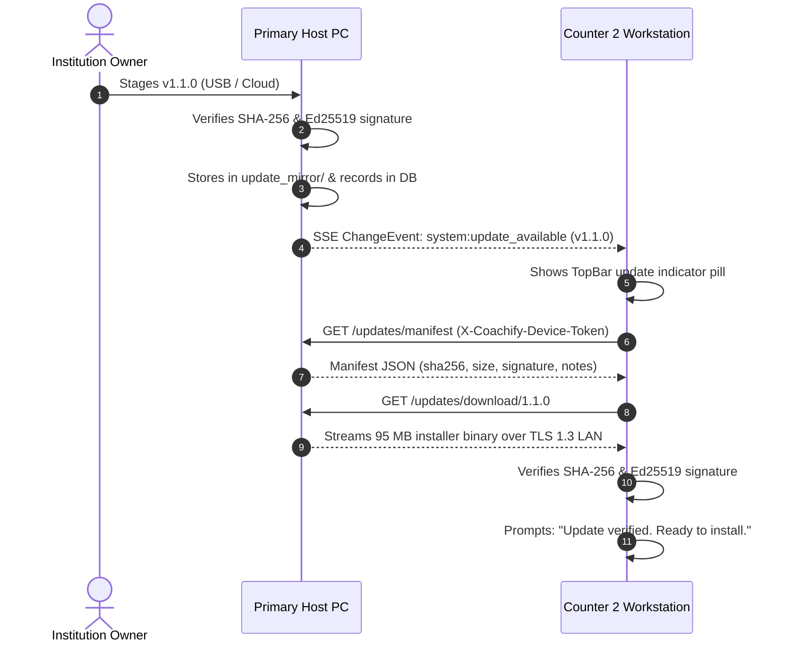

# 0048. LAN Host Update Mirror

**Date**: 2026-09-28  
**Status**: Specified / Ready for Development  
**Scope**: Feature 72 · Slice 13 (LAN Multi PC) · GA  

## Summary

In coaching centers across Bangladesh, secondary workstations (reception desks, cashier counter 1 & 2, exam coordinators) operate within a local area network (LAN) that often lacks direct, reliable, or high-bandwidth internet connectivity. While the primary Host PC (typically located in the director's office) periodically connects to the internet to fetch application updates, requiring every counter computer to individually download large installer packages (80–120 MB) over metered or patchy cellular connections is expensive, slow, and frequently impossible. Furthermore, running mismatched versions across machines (e.g., Host running schema v1.1.0 while counter workstations remain on v1.0.0) introduces operational friction and contract desynchronization.

**Feature 72: LAN Host Update Mirror** solves this by turning the primary Host PC into a secure, authenticated local mirror for Coachify Desktop releases. 

When an update is staged on the Host PC—either automatically upon host upgrade or manually imported via a USB drive for air-gapped institutions—the Host securely verifies the package's SHA-256 hash and Ed25519 digital signature and caches it in local application storage (`update_mirror/`). The Host then broadcasts an update notification down the real-time Server-Sent Events (SSE `GET /events`) control channel. Connected workstations automatically detect the staged release, display an update indicator, and download the verified installer directly from the Host over pinned TLS 1.3 at local network speeds (sub-10 seconds on standard gigabit/Wi-Fi). Before executing, the workstation cryptographically verifies the downloaded binary against the embedded vendor public key, ensuring 100% data safety, zero bandwidth waste, and complete offline survivability.

## Structure

This specification covers Feature 72 of Slice 13 (LAN Multi PC):

- [index.md](index.md): Architectural specification, acceptance criteria, data models, network protocols, state transitions, API surface, security model, and implementation tasks.
- [rationale.md](rationale.md): Architectural context, options considered (LAN host HTTP mirror vs SMB file sharing vs P2P gossip; pull vs push update triggers; manual USB ingestion vs cloud auto-cache), and trade-offs.
- [verify.md](verify.md): Automated integration test suites, network failure drills, concurrent workstation download stress tests, air-gapped USB import matrix, and manual QA procedures.

## Requirements

**User stories**:

- As a coaching center owner with limited internet, I want to download an update once on my main Host PC and have all counter workstations update from it over the local office network, so that I do not burn expensive cellular mobile data on every counter PC.
- As an air-gapped institution owner with zero internet, I want to copy a verified Coachify update installer onto a USB drive and stage it into the Host PC, so that all secondary workstations can upgrade without ever connecting to the internet.
- As a cashier on Counter 2, I want my workstation to notify me when a new update is ready on the Host PC and download it in seconds over the local Wi-Fi, so that my counter is never stuck on an outdated version.
- As a system administrator, I want to see the mirror status on the Host PC—including cached version, file size, SHA-256 checksum, and how many workstations have downloaded it—so that I know all counters are up to date.
- As a security-conscious owner, I want every workstation to strictly verify the cryptographic signature of the downloaded installer before running it, so that malicious files can never be injected over the local network.

**Acceptance criteria**:

- **AC-1: Local Mirror Cache Storage & Management**:
  - The Host maintains an update mirror directory (`%LOCALAPPDATA%\Coachify\update_mirror\`) containing staged release packages and metadata.
  - Staging can occur automatically upon host version advancement, or manually via `lan.stage_mirror_update` (importing a `.exe` installer and manifest from a local path or USB drive).
  - Storage is tracked in database table `lan_staged_updates` (version, channel, artifact filename, size, sha256, Ed25519 signature, notes, download count, active status).
- **AC-2: Pinned TLS Host Update Endpoints (`GET /updates/manifest`, `GET /updates/download/:version`)**:
  - `GET /updates/manifest`: Requires valid workstation bearer token (`X-Coachify-Device-Token` or `Authorization: Bearer devtok_...`). Returns HTTP 200 with manifest JSON (version, size_bytes, sha256, signature, channel, notes, download URL) or 404 if no mirror is active.
  - `GET /updates/download/:version`: Streams the binary over pinned TLS 1.3 with `Content-Type: application/vnd.microsoft.portable-executable` (or `application/octet-stream`), `Content-Length`, and `Content-Disposition`.
  - Unauthenticated requests receive HTTP 401; blocked or revoked device tokens receive HTTP 403.
- **AC-3: Real-Time Broadcast & SSE Notification (`system:update_available`)**:
  - When the Host stages or activates an update, it immediately emits a `ChangeEvent` (`topic: "system"`, `entity: "update"`, `action: "mirrored"`, `payload: { version: "1.1.0", file_size_bytes: 98124000 }`) across active `/events` SSE streams.
  - Workstations receive this event in under **500 ms**, invalidating client update queries and displaying an update notification pill in the top navigation bar.
- **AC-4: Workstation Update Discovery & Local LAN Download**:
  - In Workstation Client Mode, checking for updates routes to the paired Host PC (`TransportClient::check_host_update`).
  - If the Host has a newer semantic version than the workstation (`host_version > current_version`):
    - The client UI presents the update prompt: "Update v1.1.0 available from Host (OFFICE-PC)".
    - Clicking "Download from Host" initiates a fast streaming download directly over the local network into `%LOCALAPPDATA%\Coachify\staged_update.exe`.
    - Progress reporting tracks bytes downloaded, total bytes, and transfer speed.
- **AC-5: Cryptographic Verification & Pre-Update Safety**:
  - Before launching the installer, the workstation strictly validates:
    1. File size matches the manifest header.
    2. Computed SHA-256 checksum matches the manifest `sha256`.
    3. Ed25519 signature verifies against the trusted vendor public key.
  - If validation fails, the staged binary is deleted immediately with an error, preventing execution of corrupted or tampered payloads.
  - Workstation invokes `updater::prepare_for_update` before launching the setup wizard.
- **AC-6: Air-Gapped Manual Import (USB / Local File)**:
  - Supports completely air-gapped institutions via `lan.stage_mirror_update`:
    - Admin provides the installer file path and optional manifest JSON.
    - Host validates file existence, computes SHA-256, verifies signature, copies the package into `update_mirror/`, and records the release in `lan_staged_updates`.
    - Instantly notifies all paired workstations via SSE.
- **AC-7: Host Mirror Controls & Configuration UI**:
  - In Host Settings -> LAN Host Settings:
    - Display "LAN Update Mirror" card.
    - Toggle switch to enable/disable mirror serving (`lan.configure_update_mirror`).
    - Staged version status (version, size, SHA-256 fingerprint preview, served download count).
    - "Stage Update from File..." button and "Clear Staged Update" action with confirmation.
- **AC-8: Workstation Update Settings UI**:
  - In Workstation Settings Card & Update Settings Card:
    - Clear banner: "Update Source: Host PC ({host_name}) via LAN".
    - "Check Host for Updates" button.
    - Real-time download progress bar with local transfer rate.
    - "Install & Restart" button upon successful verification.
- **AC-9: Concurrency & Async Streaming Resilience**:
  - Host handles multiple concurrent workstation downloads (up to 5 simultaneous streams) without saturating the Tokio async runtime or blocking domain RPC transactions.
  - Client handles transient network drops with resume support or clean restart.
- **AC-10: Audit Log & Observability**:
  - Key mirror lifecycle events are logged to the tamper-evident SHA-256 audit trail:
    - `lan_update_mirror.staged`: recorded when an update is imported or updated.
    - `lan_update_mirror.cleared`: recorded when a mirror release is cleared.
    - `lan_update_mirror.download_completed`: recorded with downloading device ID, IP address, and duration.

## Decision

**Chosen option**: Integrated Axum TLS 1.3 Streaming Endpoints (`/updates/manifest`, `/updates/download/:version`), SQLite Metadata Table (`lan_staged_updates`), Real-Time SSE Notification Fan-Out, and Workstation Pinned Client Download Pipeline with Vendor Ed25519 Signature Verification.

We extend the Host Controller's Axum router with dedicated authenticated update endpoints that stream cached installer packages directly from `%LOCALAPPDATA%\Coachify\update_mirror\`. Workstations connect over the existing pinned TLS 1.3 connection using their bearer device token, stream the installer at LAN speeds, and verify the binary's cryptographic signature before launching. Air-gapped manual file import guarantees that institutions with zero internet connectivity across all machines can distribute updates reliably using a single USB thumb drive.

## Architecture & Data Model

### 1. Database Schema (`migrations/0027_lan_update_mirror.sql`)

```sql
-- Migration 0027: LAN Host Update Mirror Configuration & Staged Releases

CREATE TABLE IF NOT EXISTS lan_update_mirror_config (
    id TEXT PRIMARY KEY, -- 'default'
    mirror_enabled INTEGER NOT NULL DEFAULT 1 CHECK (mirror_enabled IN (0, 1)),
    storage_path TEXT, -- relative or absolute directory, defaults to app data update_mirror
    max_cached_releases INTEGER NOT NULL DEFAULT 2,
    auto_stage_on_host_update INTEGER NOT NULL DEFAULT 1 CHECK (auto_stage_on_host_update IN (0, 1)),
    created_at TEXT NOT NULL,
    updated_at TEXT NOT NULL
);

CREATE TABLE IF NOT EXISTS lan_staged_updates (
    id TEXT PRIMARY KEY, -- release version '1.1.0'
    version TEXT UNIQUE NOT NULL,
    channel TEXT NOT NULL DEFAULT 'stable' CHECK (channel IN ('internal', 'beta', 'stable')),
    artifact_filename TEXT NOT NULL,
    file_size_bytes INTEGER NOT NULL,
    sha256 TEXT NOT NULL,
    updater_signature TEXT NOT NULL,
    updater_key_id TEXT NOT NULL DEFAULT 'u2026a',
    notes TEXT NOT NULL DEFAULT '',
    min_upgrade_from TEXT,
    staged_at TEXT NOT NULL,
    downloads_count INTEGER NOT NULL DEFAULT 0,
    is_active INTEGER NOT NULL DEFAULT 1 CHECK (is_active IN (0, 1))
);

-- Trigger: Prevent deletion of default configuration
CREATE TRIGGER IF NOT EXISTS prevent_delete_lan_update_mirror_config
BEFORE DELETE ON lan_update_mirror_config
BEGIN
    SELECT RAISE(ABORT, 'LAN update mirror configuration record cannot be deleted');
END;
```

### 2. Network Protocol & API Surface

#### Host HTTPS Endpoints (Port 50443, TLS 1.3)

| Endpoint | Method | Headers / Auth | Description |
|---|---|---|---|
| `/updates/manifest` | `GET` | `X-Coachify-Device-Token` | Returns active update manifest metadata or 404 |
| `/updates/download/:version` | `GET` | `X-Coachify-Device-Token` | Streams installer binary with chunked encoding |

#### Typed RPC Commands (Dispatcher Seam)

| Command | Locality | Permission | Payload | Response |
|---|---|---|---|---|
| `lan.get_update_mirror_status` | `HostOnly` | `settings.view` | `{}` | `LanUpdateMirrorStatus` |
| `lan.configure_update_mirror` | `HostOnly` | `settings.edit` | `{ mirror_enabled: bool }` | `LanUpdateMirrorStatus` |
| `lan.stage_mirror_update` | `HostOnly` | `settings.edit` | `StageMirrorUpdateInput` | `LanUpdateMirrorStatus` |
| `lan.clear_mirror_update` | `HostOnly` | `settings.edit` | `{ version?: string }` | `LanUpdateMirrorStatus` |
| `lan.check_workstation_update` | `LocalOnly` | Public | `{}` | `WorkstationUpdateCheckResult` |
| `lan.download_workstation_update` | `LocalOnly` | Public | `{ version: string }` | `WorkstationUpdateDownloadResult` |

### 3. State Machine & Event Flow


